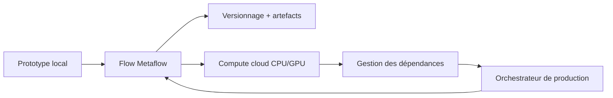

# Netflix/metaflow

> Python framework that takes an ML project from notebook to production workflow.

## The problem
Moving from prototype to production breaks the code: ad hoc experiment tracking, non-reproducible dependencies, scaling rewritten from scratch, and deployment handed to another tool.

## What it actually does
A single Python API covers three needs: local prototyping with notebooks, experiment tracking, built-in versioning and visualization; horizontal and vertical scaling in your cloud, CPU and GPU alike, with fast data access for massively parallel or gang-scheduled workloads; dependency management and one-click deployment to highly available production orchestrators, with reactive orchestration. Created at Netflix, now supported by Outerbounds.

## How it is wired


## Trying it
```bash
pip install metaflow
conda install -c conda-forge metaflow
```

## Cost and gotchas
Free locally. The real benefits (external compute, production orchestrator) require deploying the infrastructure in your cloud, following the dedicated guide: the bill is yours. The Metaflow sandbox lets you try it without installing anything.

## What it is not
Not a managed platform: the repo is the library, the infrastructure is still yours to set up (or to buy from Outerbounds). Not a modeling tool: it orchestrates, it does not train for you. No license stated in the README.

## Alternatives
No alternative repo is named in the README.

## For you
The reasonable choice for structuring an ML project meant to last, without rewriting when going to production.
