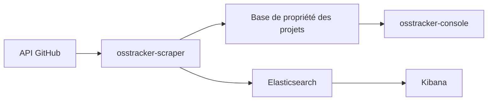

# Netflix/osstracker

> Dashboard that aggregates the GitHub metrics of all of an organization's projects, for its open source leads.

## The problem
An organization with dozens of repositories has no overview: who owns what, how many issues are piling up, which projects have been abandoned.

## What it actually does
Periodic jobs (osstracker-scraper) collect GitHub data and feed a project ownership database and a time-series database. A web application (osstracker-console) lets you classify projects by domain and assign owners. Historical charts go through Kibana on Elasticsearch.

## How it is wired
Simplified diagram based on the sheet, no diagram provided.


## Trying it
```bash
# Aucune commande documentée dans le README.
# Il renvoie vers un projet d'exemple Terraform + Ansible pour le déploiement.
```

## Cost and gotchas
You have to self-host Elasticsearch, Kibana and the ownership database; deployment is only described by reference to another project. Last push in March 2024.

## What it is not
Not a tool ready to install in one command. Not a tracker for personal repositories: it targets a whole organization with roles (community manager, shepherds, owners).

## Alternatives
No alternative named in the README.

## For you
Ignore: designed for a large open source organization, with an Elasticsearch stack to host, and not updated since March 2024.
