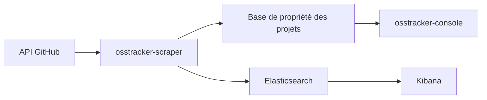

# Netflix/osstracker

> Tableau de bord qui agrège les métriques GitHub de tous les projets d'une organisation, pour ses responsables open source.

## Le problème
Une organisation avec des dizaines de dépôts n'a aucune vue d'ensemble : qui est responsable de quoi, combien d'issues traînent, quels projets sont à l'abandon.

## Ce que ça fait vraiment
Des jobs périodiques (osstracker-scraper) collectent les données GitHub et alimentent une base de propriété des projets et une base de séries temporelles. Une application web (osstracker-console) permet de classer les projets par domaine et de désigner des responsables. Les graphes historiques passent par Kibana sur Elasticsearch.

## Comment c'est branché
Schéma simplifié d'après la fiche, sans diagramme fourni.


## Essayer
```bash
# Aucune commande documentée dans le README.
# Il renvoie vers un projet d'exemple Terraform + Ansible pour le déploiement.
```

## Coût et pièges
Il faut héberger soi-même Elasticsearch, Kibana et la base de propriété ; le déploiement n'est décrit que par renvoi vers un autre projet. Dernier push en mars 2024.

## Ce que ce n'est pas
Pas un outil prêt à installer en une commande. Pas un suivi de dépôts personnels : il vise une organisation entière avec des rôles (community manager, shepherds, propriétaires).

## Alternatives
Aucune alternative nommée dans le README.

## Pour toi
À ignorer : conçu pour une grande organisation open source, avec une pile Elasticsearch à héberger, et plus mis à jour depuis mars 2024.

