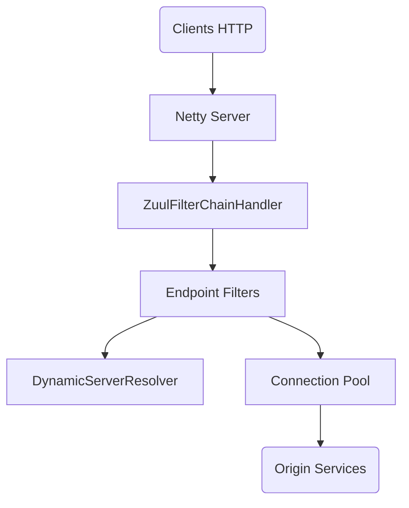

# Netflix/zuul

> Layer 7 application gateway in Java, for dynamic routing, monitoring and resilience of microservices.

## The problem
Exposing microservices requires an entry point that routes, filters and monitors traffic asynchronously.

## What it actually does
Netty server that handles HTTP/1 and HTTP/2 requests through a chain of filters (inbound, endpoint, outbound), resolves origin servers through a discovery module and manages a connection pool. Dynamic properties and metrics included. An annotation processor registers filters at compile time. The README is mostly a list of articles and links.

## How it is wired

## Trying it
No usage command in the README: it points to the wiki. Only publishing a release is described, via the GitHub interface.

## Cost and gotchas
Free. It is a JVM library to integrate, with no graphical interface. The wiki is the real documentation.

## What it is not
Not a ready-to-run product: it is a framework to embed. Not related to data or AI.

## Alternatives
- Spring Cloud and JHipster: cited projects that use Zuul.

## For you
Worth watching: only if you operate JVM microservices; unrelated to data or AI work.
