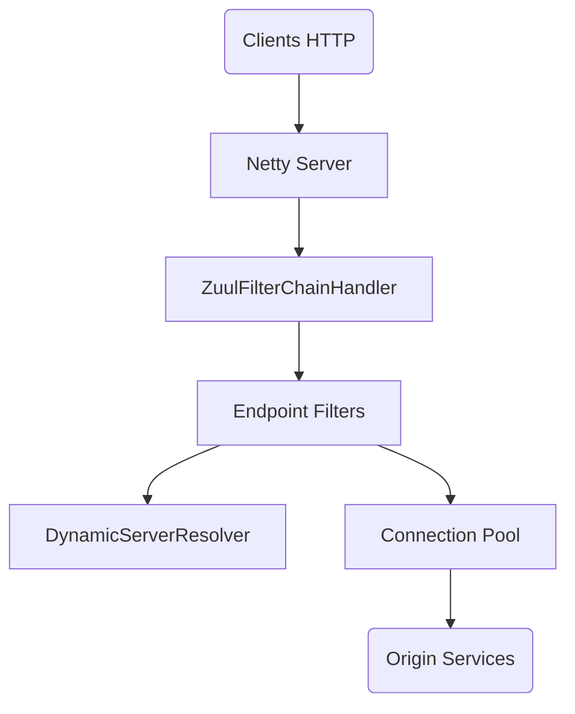

# Netflix/zuul

> Passerelle applicative de niveau 7 en Java, pour routage dynamique, surveillance et résilience des microservices.

## Le problème
Exposer des microservices demande un point d'entrée qui route, filtre et surveille le trafic de façon asynchrone.

## Ce que ça fait vraiment
Serveur Netty qui traite les requêtes HTTP/1 et HTTP/2 via une chaîne de filtres (entrants, point de sortie, sortants), résout les serveurs d'origine via un module de découverte et gère un pool de connexions. Propriétés dynamiques et métriques inclus. Un processeur d'annotations enregistre les filtres à la compilation. Le README est surtout une liste d'articles et de liens.

## Comment c'est branché

## Essayer
Aucune commande d'utilisation dans le README : il renvoie au wiki. Seule la publication d'une release est décrite, via l'interface GitHub.

## Coût et pièges
Gratuit. C'est une bibliothèque JVM à intégrer, sans interface graphique. Le wiki est la vraie documentation.

## Ce que ce n'est pas
Pas un produit prêt à lancer : c'est un cadre à embarquer. Pas lié à la data ou à l'IA.

## Alternatives
- Spring Cloud et JHipster : projets cités qui utilisent Zuul.

## Pour toi
À surveiller : seulement si tu opères des microservices JVM ; sans rapport avec un travail data ou IA.

