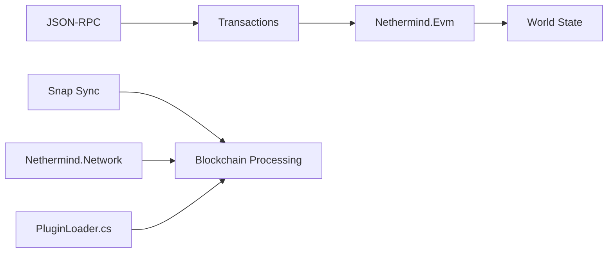

# NethermindEth/nethermind

> Ethereum execution client written in .NET, with a plugin system, for node operators.

## The problem
Running an Ethereum node while diversifying the network's implementations.

## What it actually does
Processes transactions and blocks (EVM, world state), synchronizes (snap sync by default), exposes JSON-RPC (HTTP, WebSocket, IPC), health and Prometheus metrics. A plugin system adds consensus, transaction types, P2P protocols and RPC namespaces; L2 support (OP Stack) depends on it. Execution witness capture for ZK is in progress.

## How it is wired


## Trying it
```bash
sudo apt-get install nethermind
nethermind -c mainnet --data-dir path/to/data/dir
docker build https://github.com/nethermindeth/nethermind.git -t nethermind
```

## Cost and gotchas
Free, but the disk, memory and bandwidth of a full node are on you (hardware: see "System requirements"). .NET SDK 10 to build. GPL-3.0.

## What it is not
Not a consensus client: it pairs with a consensus client (Sedge cited).

## Alternatives
Geth: same JSON-RPC API, migration guide provided.

## For you
Ignore: blockchain infrastructure, unrelated to your data/AI/MLOps work.
