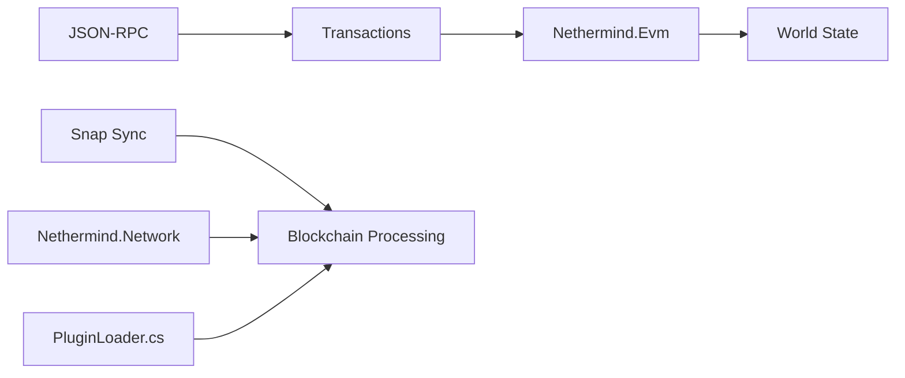

# NethermindEth/nethermind

> Client d'exécution Ethereum écrit en .NET, avec système de plugins, pour opérateurs de nœuds.

## Le problème
Faire tourner un nœud Ethereum en diversifiant les implémentations du réseau.

## Ce que ça fait vraiment
Traite transactions et blocs (EVM, état du monde), synchronise (snap sync par défaut), expose JSON-RPC (HTTP, WebSocket, IPC), santé et métriques Prometheus. Un système de plugins ajoute consensus, types de transactions, protocoles P2P et espaces RPC ; le support L2 (OP Stack) en dépend. Capture de témoin d'exécution pour le ZK en cours.

## Comment c'est branché


## Essayer
```bash
sudo apt-get install nethermind
nethermind -c mainnet --data-dir path/to/data/dir
docker build https://github.com/nethermindeth/nethermind.git -t nethermind
```

## Coût et pièges
Gratuit, mais disque, mémoire et bande passante d'un nœud complet sont à ta charge (matériel : voir « System requirements »). .NET SDK 10 pour compiler. GPL-3.0.

## Ce que ce n'est pas
Pas un client de consensus : il se couple à un client de consensus (Sedge cité).

## Alternatives
Geth : même API JSON-RPC, guide de migration fourni.

## Pour toi
À ignorer : infrastructure blockchain, sans lien avec ton travail data/IA/MLOps.

