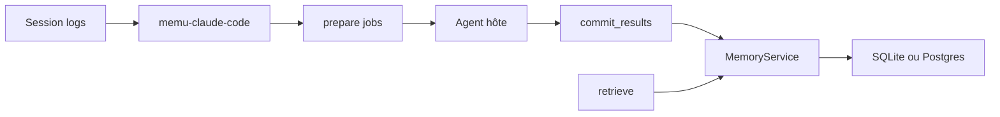

# NevaMind-AI/memU

> Shared Markdown wiki memory for coding agents, fed by their session histories.

## The problem
Each agent (Claude Code, Codex, Cursor…) forgets everything between sessions and shares nothing with the others.

## What it actually does
Per-host adapters (`memu-claude-code`, `memu-codex`…) that read the session logs and patch the instructions file.
A scheduled task splits the sessions into jobs; the agent itself extracts Markdown memories and skills from them, then `commit`.
`MemoryService` calls no LLM: it stores, embeds and retrieves.
Backends: memU cloud, SQLite, Postgres/pgvector; embeddings from OpenAI, Jina, Voyage…

## How it is wired


## Trying it
```bash
pip install memu-cli
memu-codex retrieve "What should I remember about this project?"
```

## Cost and gotchas
A memu.so key for the cloud, or an embedding key locally. Installation goes through a remote SKILL.md executed by your agent.

## What it is not
Not a standalone memory server with an LLM: the synthesis relies on your agent. Support varies by host and OS.

## Alternatives
No alternative named in the README.

## For you
Worth watching: automatic skill extraction from your Claude Code sessions is relevant, but having your agent run a remote script calls for caution.
