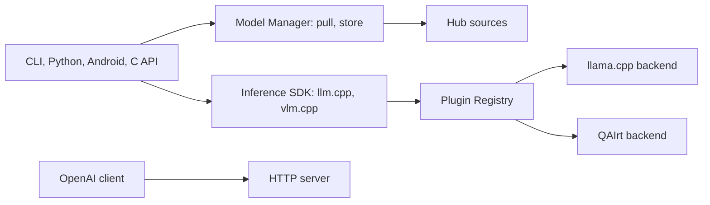

# NexaAI/nexa-sdk

> On-device inference runtime (LLM and VLM) for Qualcomm chips: Hexagon NPU, Adreno GPU or CPU.

## The problem
Running language and vision models locally on Snapdragon devices while making use of their NPU, with very different model formats.

## What it actually does
The README presents "GenieX", the community edition of Qualcomm GENIE (the repo is called nexa-sdk: note the name mismatch). A single C SDK is exposed through a CLI (`geniex infer`), Python, Kotlin/Java, Docker and an OpenAI-compatible server. Two runtimes: llama.cpp (GGUF from Hugging Face, NPU/GPU/CPU) and Qualcomm AI Engine Direct (bundles compiled from AI Hub, NPU only).

## How it is wired


## Trying it
```bash
curl -fsSL https://qaihub-public-assets.s3.us-west-2.amazonaws.com/qai-hub-geniex/install.sh | sh
geniex infer google/gemma-4-E4B-it-qat-q4_0-gguf
pip install geniex
geniex pull ai-hub-models/Qwen3-4B-Instruct-2507
geniex serve
```
The server listens on http://127.0.0.1:18181/v1.

## Cost and gotchas
Free. Targets Windows ARM64, Linux ARM64 and Android: you need a Qualcomm device. The README recommends `Q4_0` precision for the best Hexagon NPU support. Installation is done via `curl | sh`.

## What it is not
It is not a runtime for NVIDIA GPUs or Macs: the README only targets Qualcomm devices. The README gives no performance figures.

## Alternatives
llama.cpp is used as a backend, not as a competitor.

## For you
Keep an eye on it: interesting if you deploy embedded AI on Snapdragon, but limited to that hardware, version 0.3 on Android and ambiguous naming.
