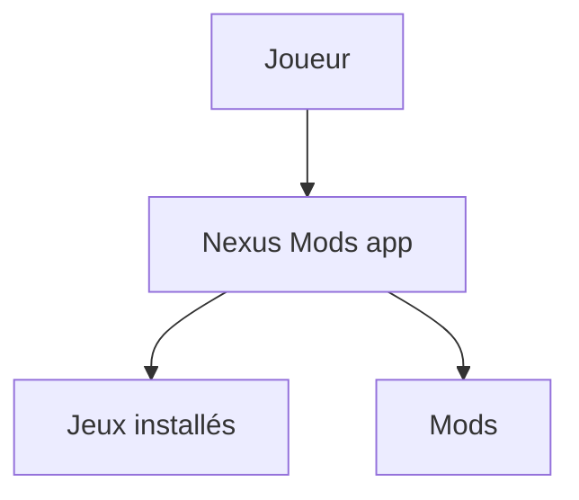

# Nexus-Mods/NexusMods.App

> Application for installing and managing game mods, on Windows and Linux.

## The problem
Installing and maintaining game mods by hand is tedious and breaks easily.

## What it actually does
The README announces an installer, creator and manager of mods for many games, on Windows and Linux. No technical detail: everything points to the wiki, so not documented here.

## How it is wired
Simplified diagram based on the fiche, no diagram provided.


## Trying it
```bash
# Aucune commande documentée : voir le wiki.
```

## Cost and gotchas
The repository is archived (last push early 2026), so no more fixes here. A Nexus Mods account will probably be needed, not specified in the README.

## What it is not
Not a development or data tool.

## Alternatives
No alternative named in the README.

## For you
Ignore: a gaming tool, archived repository, unrelated to your profile.
