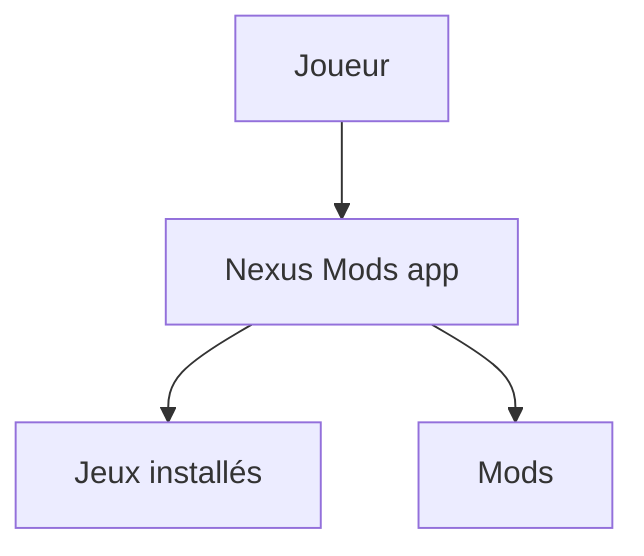

# Nexus-Mods/NexusMods.App

> Application d'installation et de gestion de mods de jeux, sous Windows et Linux.

## Le problème
Installer et maintenir des mods de jeux à la main est fastidieux et casse facilement.

## Ce que ça fait vraiment
Le README annonce un installateur, créateur et gestionnaire de mods pour de nombreux jeux, sur Windows et Linux. Aucun détail technique : tout renvoie au wiki, donc non documenté ici.

## Comment c'est branché
Schéma simplifié d'après la fiche, sans diagramme fourni.


## Essayer
```bash
# Aucune commande documentée : voir le wiki.
```

## Coût et pièges
Le dépôt est archivé (dernier push début 2026), donc plus de correctifs ici. Un compte Nexus Mods sera probablement nécessaire, non précisé dans le README.

## Ce que ce n'est pas
Pas un outil de développement ni de données.

## Alternatives
Aucune alternative nommée dans le README.

## Pour toi
Ignorer : outil de jeux, dépôt archivé, sans rapport avec ton profil.

