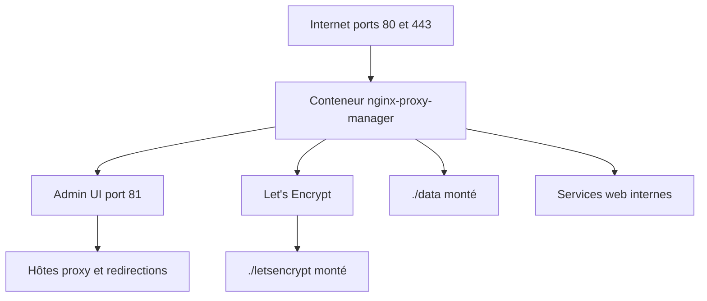

# NginxProxyManager/nginx-proxy-manager

> Docker image that exposes services behind Nginx with Let's Encrypt SSL, through a web interface.

## The problem
Publishing a self-hosted service requires writing Nginx configuration and managing certificate renewal.
One configuration mistake and the site goes down, or worse, stays in clear text.

## What it actually does
Prebuilt Docker image: you describe your proxy hosts, redirections, streams and 404 pages from an admin interface, without writing any Nginx.
Free SSL through Let's Encrypt, or custom certificates provided by you.
Access lists and basic HTTP authentication per host; user management, permissions and an audit log.
Advanced Nginx configuration is available for cases the interface does not cover — optional by design.

## How it is wired


## Trying it
```yml
services:
  app:
    image: 'docker.io/jc21/nginx-proxy-manager:latest'
    restart: unless-stopped
    ports:
      - '80:80'
      - '81:81'
      - '443:443'
    volumes:
      - ./data:/data
      - ./letsencrypt:/etc/letsencrypt
```

```bash
docker compose up -d
```

## Cost and gotchas
Free. The cost is exposure: you have to open 80 and 443 on your router and point a domain name (DuckDNS, Route53, Cloudflare).
`armv7` is no longer supported from version 2.14; stay on the `2.13.7` tag in that case.

## What it is not
It is not a WAF or DDoS protection: it is a reverse proxy with TLS termination.
It is not made for complex Nginx configurations: the project claims simplicity as a goal, the advanced options remain an escape hatch.
It is not free of attack surface: the admin interface on port 81 must stay protected.

## Alternatives
No alternative is named in the README.

## For you
The obvious shortcut to cleanly expose your personal services or a demo server; nothing to learn.
