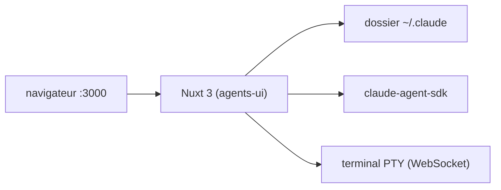

# Ngxba/claude-code-cli-ui

> Local Nuxt dashboard to visually manage Claude Code agents, commands and skills.

## The problem
The agents, commands and skills in `~/.claude` are scattered Markdown files: you lose track of dependencies and costs.

## What it actually does
Reads and writes the `~/.claude` folder directly. Offers an agent editor, a relationship graph between agents, commands and skills, a workflow builder, a PTY terminal and token and cost metrics. An agent test bench uses Anthropic's agent SDK over SSE.

## How it is wired
Simplified diagram based on the sheet, no diagram provided.



## Trying it
```bash
git clone https://github.com/Ngxba/claude-code-agents-ui.git
cd claude-code-agents-ui
bun install
bun run dev
```

## Cost and gotchas
Reuses your existing Anthropic configuration: agent trials consume your quota or credits. It writes into `~/.claude`: back it up first. Bun recommended, otherwise Node 18+. The desktop app is announced as "coming soon".

## What it is not
Neither a replacement for the CLI, nor a model provider, nor a hosted service: everything runs locally.

## Alternatives
No alternative named in the README.

## For you
Worth watching: handy if you accumulate many Claude Code agents and skills, but it modifies your real configuration and depends on a single author.
