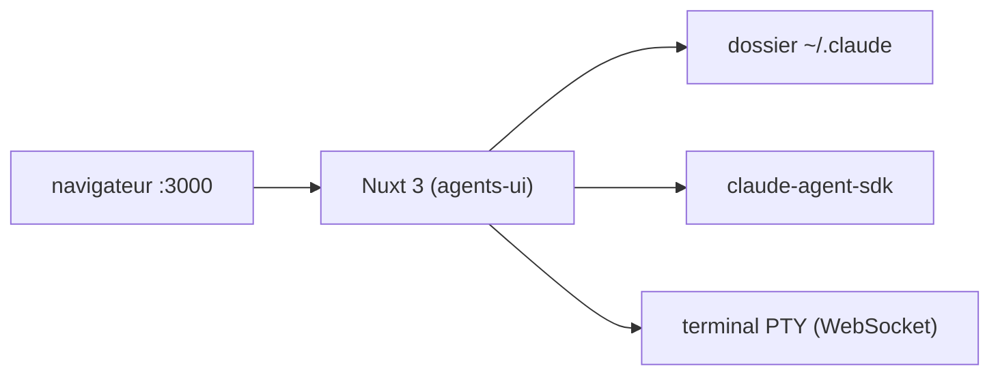

# Ngxba/claude-code-cli-ui

> Tableau de bord Nuxt local pour gérer visuellement agents, commandes et skills de Claude Code.

## Le problème
Les agents, commandes et skills de `~/.claude` sont des fichiers Markdown dispersés : on perd le fil des dépendances et des coûts.

## Ce que ça fait vraiment
Lit et écrit directement le dossier `~/.claude`. Propose un éditeur d'agents, un graphe de relations entre agents, commandes et skills, un constructeur de workflows, un terminal PTY et des métriques de jetons et de coûts. Un banc d'essai d'agents utilise le SDK d'agents d'Anthropic en SSE.

## Comment c'est branché
Schéma simplifié d'après la fiche, sans diagramme fourni.



## Essayer
```bash
git clone https://github.com/Ngxba/claude-code-agents-ui.git
cd claude-code-agents-ui
bun install
bun run dev
```

## Coût et pièges
Réutilise ta configuration Anthropic existante : les essais d'agents consomment ton quota ou tes crédits. Il écrit dans `~/.claude` : sauvegarde avant. Bun conseillé, sinon Node 18+. L'application de bureau est annoncée « bientôt ».

## Ce que ce n'est pas
Ni un remplaçant du CLI, ni un fournisseur de modèles, ni un service hébergé : tout tourne en local.

## Alternatives
Aucune alternative nommée dans le README.

## Pour toi
Surveiller : pratique si tu accumules beaucoup d'agents et de skills Claude Code, mais il modifie ta configuration réelle et dépend d'un seul auteur.

