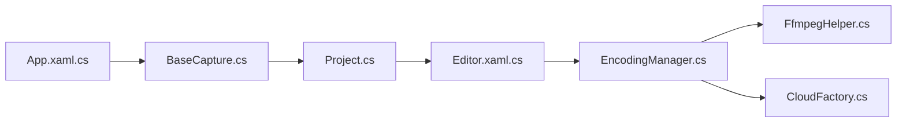

# NickeManarin/ScreenToGif

> Screen, webcam and sketch recorder for Windows, with an animation editor and GIF export.

## The problem
Capturing a screen or webcam and converting it into a lightweight GIF, with frame editing, without heavy software.

## What it actually does
The README is mostly a list of donation links. The architecture derived from the code shows three recorders (screen, webcam, sketch), an editable frame project in the editor, an encoding manager (GIF, APNG, video, PSD, images) going through FFmpeg, and an optional upload to Imgur or Yandex Disk.

## How it is wired

## Trying it
No documented command: the README asks for the .NET 9 Desktop Runtime or later and points to the website, Chocolatey, FOSSHUB or the Microsoft Store.

## Cost and gotchas
Free. Windows and .NET 9 required. MS-PL license, file-level copyleft.

## What it is not
Not cross-platform. The README asks not to resell the application under another name.

## Alternatives
No alternative named in the README.

## For you
Watch: handy for illustrating a demo or documentation with GIFs on Windows, otherwise of no consequence for your work.
