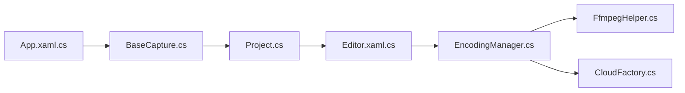

# NickeManarin/ScreenToGif

> Enregistreur d'écran, de webcam et de croquis pour Windows, avec éditeur d'animation et export GIF.

## Le problème
Capturer un écran ou une webcam et le convertir en GIF léger, en retouchant les images, sans logiciel lourd.

## Ce que ça fait vraiment
Le README est surtout une liste de liens de dons. L'architecture dérivée du code montre trois enregistreurs (écran, webcam, croquis), un projet d'images modifiable dans l'éditeur, un gestionnaire d'encodage (GIF, APNG, vidéo, PSD, images) passant par FFmpeg, et un envoi optionnel vers Imgur ou Yandex Disk.

## Comment c'est branché

## Essayer
Aucune commande documentée : le README demande le .NET 9 Desktop Runtime ou supérieur et renvoie au site, à Chocolatey, FOSSHUB ou au Microsoft Store.

## Coût et pièges
Gratuit. Windows et .NET 9 requis. Licence MS-PL, copyleft au niveau des fichiers.

## Ce que ce n'est pas
Pas multiplateforme. Le README demande de ne pas revendre l'application sous un autre nom.

## Alternatives
Aucune alternative nommée dans le README.

## Pour toi
À surveiller : pratique pour illustrer une démo ou une documentation en GIF sous Windows, sinon sans enjeu pour ton métier.

