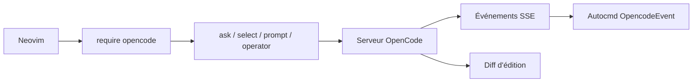

# NickvanDyke/opencode.nvim

> Neovim plugin that connects the editor to OpenCode, a coding agent, by injecting context.

## The problem
Using a coding agent from Neovim forces you to copy-paste context and reload modified files.

## What it actually does
Connects to an OpenCode server (existing or launched), injects contexts (`@this`, `@buffer`, `@diagnostics`…), offers predefined prompts, relays server events as autocmds, reloads modified buffers and displays edit requests as a diff with accept or reject.

## How it is wired


## Trying it
```lua
vim.pack.add({
  { src = "https://github.com/nickjvandyke/opencode.nvim" },
})
vim.g.opencode_opts = {}
vim.keymap.set({ "n", "x" }, "<C-a>", function() require("opencode").ask("@this: ") end, { desc = "Ask OpenCode…" })
```
Then `:checkhealth opencode`.

## Cost and gotchas
OpenCode must be installed and configured; model providers and their billing are not described. Event payloads follow OpenCode and may change. The main branch targets OpenCode v2.

## What it is not
Not an agent: only a bridge to OpenCode. Files are read from disk: you must save first.

## Alternatives
No alternative named in the README.

## For you
Worth watching: useful if you code in Neovim with OpenCode; useless otherwise, the plugin is only worth the agent behind it.
