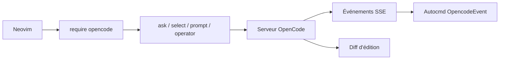

# NickvanDyke/opencode.nvim

> Plugin Neovim qui relie l'éditeur à OpenCode, agent de code, en injectant le contexte.

## Le problème
Utiliser un agent de code depuis Neovim oblige à copier-coller du contexte et à recharger les fichiers modifiés.

## Ce que ça fait vraiment
Se connecte à un serveur OpenCode (existant ou lancé), injecte des contextes (`@this`, `@buffer`, `@diagnostics`…), propose des prompts prédéfinis, relaie les événements du serveur en autocmds, recharge les buffers modifiés et affiche les demandes d'édition en diff avec accepter ou rejeter.

## Comment c'est branché


## Essayer
```lua
vim.pack.add({
  { src = "https://github.com/nickjvandyke/opencode.nvim" },
})
vim.g.opencode_opts = {}
vim.keymap.set({ "n", "x" }, "<C-a>", function() require("opencode").ask("@this: ") end, { desc = "Ask OpenCode…" })
```
Puis `:checkhealth opencode`.

## Coût et pièges
Il faut OpenCode installé et configuré ; les fournisseurs de modèles et leur facture ne sont pas décrits. Les charges utiles d'événements suivent OpenCode et peuvent changer. La branche principale cible OpenCode v2.

## Ce que ce n'est pas
Pas un agent : seulement un pont vers OpenCode. Les fichiers sont lus depuis le disque : il faut sauvegarder avant.

## Alternatives
Aucune alternative nommée dans le README.

## Pour toi
Surveiller : utile si tu codes sous Neovim avec OpenCode ; inutile sinon, le plugin ne vaut que par l'agent derrière.

