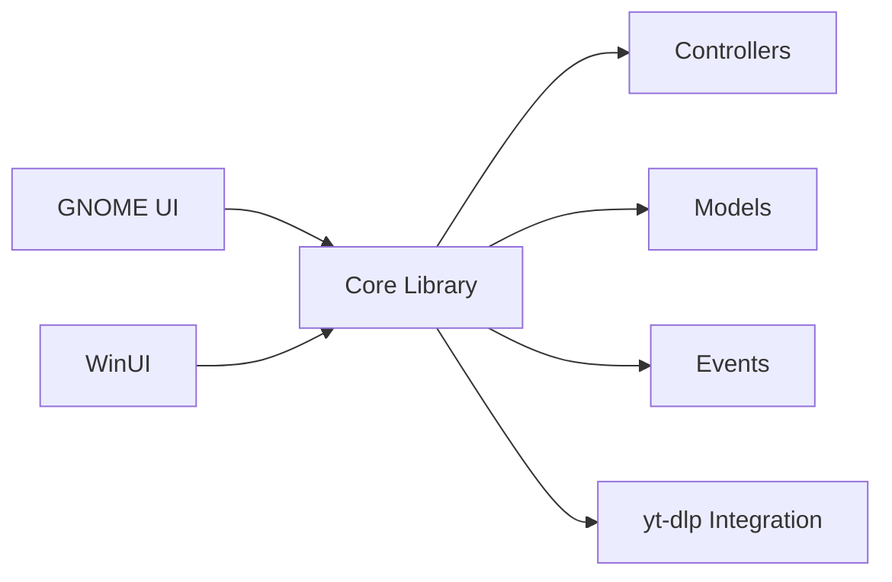

# NickvisionApps/Parabolic

> Graphical interface for yt-dlp: download video and audio from hundreds of sites, in parallel.

## The problem
yt-dlp is powerful but used from the command line.

## What it actually does
.NET 10 frontend with two interfaces (GNOME/GTK4 and WinUI) on top of a shared core. Formats mp4, webm, mp3, opus, flac, wav; concurrent downloads; metadata and subtitles. Chrome and Firefox browser extensions.

## How it is wired


## Trying it
```bash
dotnet run --project Nickvision.Parabolic.GNOME
dotnet run --project Nickvision.Parabolic.WinUI
```
Windows and macOS binaries on the Releases page.

## Cost and gotchas
Free. README legal warning: copyright and DMCA, user's responsibility. Build: .NET 10, gettext, Gtk4/libadwaita or WindowsAppSDK.

## What it is not
Not a download engine: it depends on yt-dlp. The described architecture (C++/Qt) does not match the README (.NET), a sign of an outdated diagram.

## Alternatives
No alternative named in the README.

## For you
Worth watching: handy for fetching videos or audio to transcribe, but mind the legal framework.
