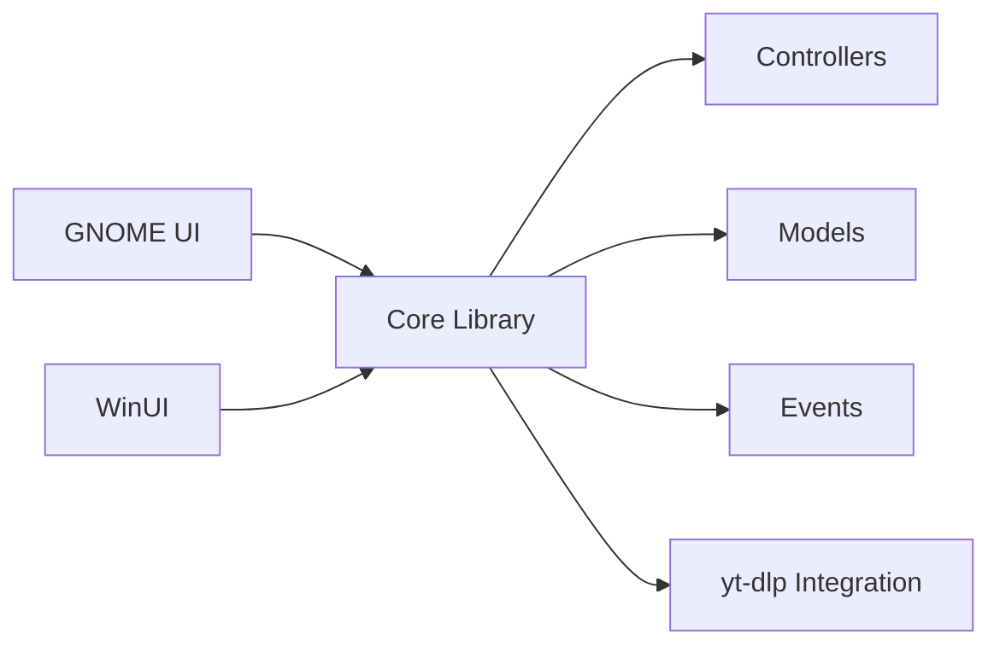

# NickvisionApps/Parabolic

> Interface graphique pour yt-dlp : télécharger vidéo et audio de centaines de sites, en parallèle.

## Le problème
yt-dlp est puissant mais s'utilise en ligne de commande.

## Ce que ça fait vraiment
Frontend .NET 10 en deux interfaces (GNOME/GTK4 et WinUI) au-dessus d'un cœur commun. Formats mp4, webm, mp3, opus, flac, wav ; téléchargements concurrents ; métadonnées et sous-titres. Extensions navigateur Chrome et Firefox.

## Comment c'est branché


## Essayer
```bash
dotnet run --project Nickvision.Parabolic.GNOME
dotnet run --project Nickvision.Parabolic.WinUI
```
Binaires Windows et macOS sur la page Releases.

## Coût et pièges
Gratuit. Avertissement légal du README : droits d'auteur et DMCA, responsabilité de l'utilisateur. Compilation : .NET 10, gettext, Gtk4/libadwaita ou WindowsAppSDK.

## Ce que ce n'est pas
Pas un moteur de téléchargement : il dépend de yt-dlp. L'architecture décrite (C++/Qt) ne correspond pas au README (.NET), signe d'un diagramme périmé.

## Alternatives
Aucune alternative nommée dans le README.

## Pour toi
À surveiller : pratique pour récupérer des vidéos ou du son à transcrire, mais attention au cadre légal.

