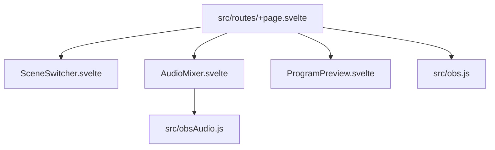

# Niek/obs-web

> Web remote control for OBS Studio, usable from any browser, desktop or mobile.

## The problem
Control OBS remotely (switch scenes, start recording) without installing additional software.

## What it actually does
Svelte page connected to OBS's obs-websocket server (v28 or later): scene switching, starting and stopping streaming and recording, Studio mode, virtual camera, audio mixer, 1 frame-per-second preview, profiles and scene collections.

## How it is wired


## Trying it
```bash
npm ci
npm run dev
docker run --rm -p8080:8080 ghcr.io/niek/obs-web
```

## Cost and gotchas
Free. You must enable OBS's WebSocket server. For access outside the local network, a WSS tunnel is needed. Build: Node.js 22.17 or later.

## What it is not
Not a replacement for OBS: it only controls it.

## Alternatives
No alternative named in the README.

## For you
Ignore: useful for streaming, not for data/AI work.
