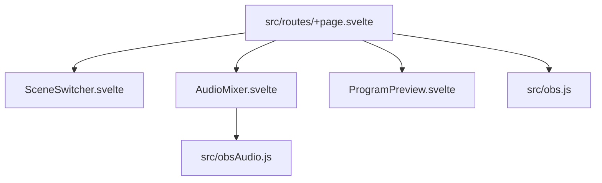

# Niek/obs-web

> Télécommande web pour OBS Studio, utilisable depuis tout navigateur, ordinateur ou mobile.

## Le problème
Piloter OBS à distance (changer de scène, lancer l'enregistrement) sans installer de logiciel supplémentaire.

## Ce que ça fait vraiment
Page Svelte reliée au serveur obs-websocket d'OBS (v28 ou plus) : changement de scènes, démarrage et arrêt du streaming et de l'enregistrement, mode Studio, caméra virtuelle, mixeur audio, aperçu à 1 image par seconde, profils et collections de scènes.

## Comment c'est branché


## Essayer
```bash
npm ci
npm run dev
docker run --rm -p8080:8080 ghcr.io/niek/obs-web
```

## Coût et pièges
Gratuit. Il faut activer le serveur WebSocket d'OBS. Pour un accès hors réseau local, un tunnel WSS est nécessaire. Build : Node.js 22.17 ou plus.

## Ce que ce n'est pas
Pas un remplaçant d'OBS : il le commande seulement.

## Alternatives
Aucune alternative nommée dans le README.

## Pour toi
Ignorer : utile pour du streaming, pas pour du travail data/IA.

