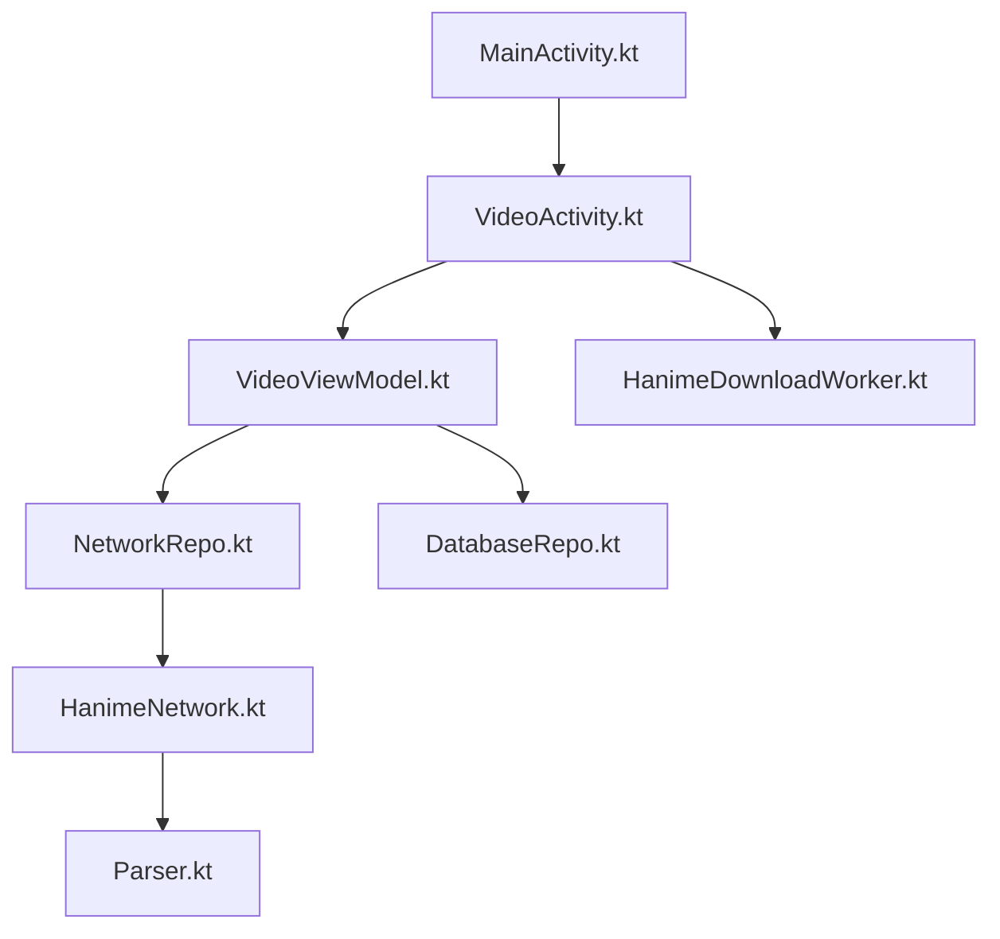

# Night-stars-1/Han1meViewer

> Android app in Kotlin for browsing and watching animation videos, with Anime4K upscaling.

## The problem
Browsing an animation video site on mobile without a dedicated app is uncomfortable.

## What it actually does
The app parses the site's pages with a parser, through a network repository called by the ViewModels, and handles favorites, history, themes, picture-in-picture and downloads through a worker. It integrates Anime4K super-resolution and the mpv player.

## How it is wired


## Trying it
```bash
git clone https://github.com/Night-stars-1/Han1meViewer.git
```
Then open the project in Android Studio and build to an Android device.

## Cost and gotchas
Free. Built with Android Studio. Last push in October 2025, more than a year ago: uncertain maintenance. README in Chinese.

## What it is not
Not an original project: it cites YenalyLiew's Han1meViewer project as its origin. Depends on a third-party site whose pages it parses.

## Alternatives
No alternative named in the README.

## For you
Ignore: a consumer video player, with no link to data, AI or MLOps work.
