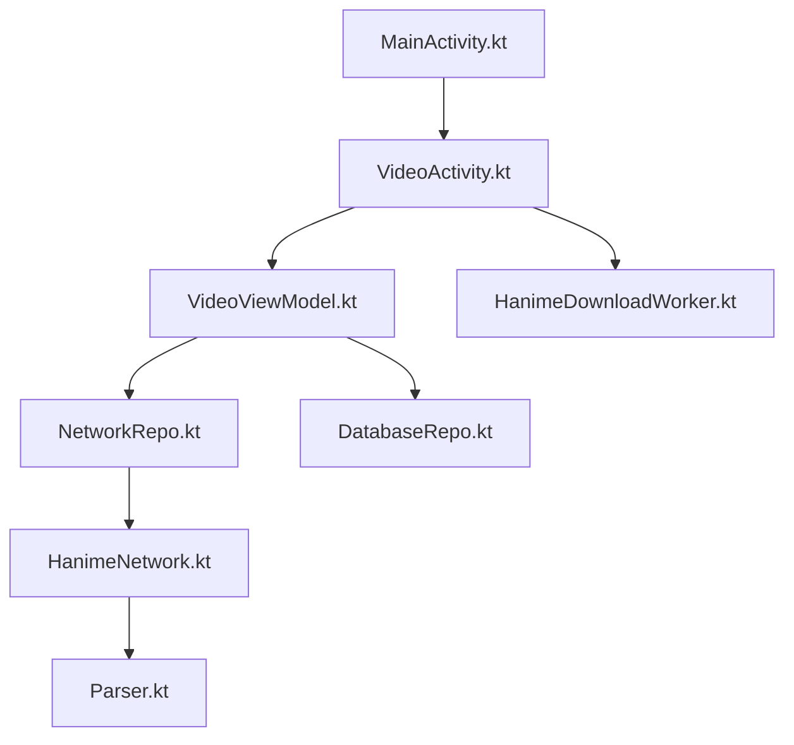

# Night-stars-1/Han1meViewer

> Application Android en Kotlin pour parcourir et lire des vidéos d'animation, avec agrandissement Anime4K.

## Le problème
Parcourir un site de vidéos d'animation sur mobile sans application dédiée manque de confort.

## Ce que ça fait vraiment
L'application analyse les pages du site avec un parseur, via un dépôt réseau appelé par les ViewModel, gère favoris, historique, thèmes, image dans l'image et téléchargements par un worker. Elle intègre la super-résolution Anime4K et le lecteur mpv.

## Comment c'est branché


## Essayer
```bash
git clone https://github.com/Night-stars-1/Han1meViewer.git
```
Puis ouvrir le projet dans Android Studio et compiler vers un appareil Android.

## Coût et pièges
Gratuit. Compilation avec Android Studio. Dernier push en octobre 2025, soit plus d'un an : maintenance incertaine. README en chinois.

## Ce que ce n'est pas
Pas un projet original : il cite le projet Han1meViewer de YenalyLiew comme origine. Dépend d'un site tiers dont il analyse les pages.

## Alternatives
Aucune alternative nommée dans le README.

## Pour toi
À ignorer : un lecteur vidéo grand public, sans lien avec un travail data, IA ou MLOps.

