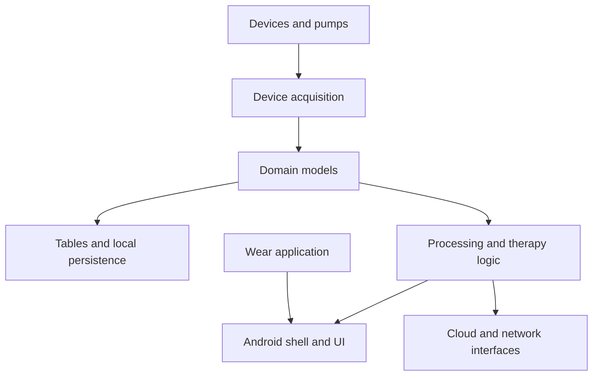

# NightscoutFoundation/xDrip

> An Android application that centralizes glucose, treatments and sensor data for people with diabetes.

## The problem
Glucose sensors, pumps, watches and tracking services each speak their own protocol, with no single gathering point.

## What it actually does
An Android hub that receives data from many glucose sensors and readers (Dexcom, Libre, Medtrum) over Bluetooth or NFC. It records them, applies calibration and predictive alerts, plots curves and logs treatments. It syncs with Nightscout, Tidepool, MongoDB, InfluxDB and AndroidAPS, and offers a Wear OS app.

## How it is wired
Simplified diagram based on the code's diagram.



## Trying it
```bash
# Aucune commande dans le README : installer l'APK depuis la page d'information
# (https://jamorham.github.io/#xdrip-plus).
```

## Cost and gotchas
Free, no sign-up. Unofficial application for research use: do not rely on it alone for a medical decision.

## What it is not
It is not a certified medical device; the README presents it as a personal research tool. It is not a cloud service.

## Alternatives
- AndroidAPS: exchanges data live with xDrip.

## For you
Ignore for a data / AI / MLOps profile: it is an Android medical application unrelated to your field.
