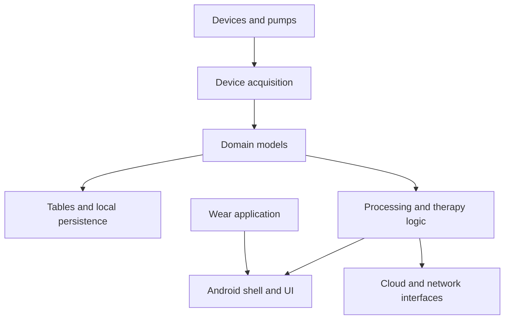

# NightscoutFoundation/xDrip

> Application Android qui centralise glycémie, traitements et données de capteurs pour personnes diabétiques.

## Le problème
Capteurs de glycémie, pompes, montres et services de suivi parlent chacun leur protocole, sans point de rassemblement.

## Ce que ça fait vraiment
Un concentrateur Android qui reçoit les données de nombreux capteurs et lecteurs de glycémie (Dexcom, Libre, Medtrum) par Bluetooth ou NFC. Il les enregistre, applique calibration et alertes prédictives, trace des courbes et saisit les traitements. Il synchronise avec Nightscout, Tidepool, MongoDB, InfluxDB et AndroidAPS, et propose une application Wear OS.

## Comment c'est branché
Schéma simplifié d'après le diagramme du code.



## Essayer
```bash
# Aucune commande dans le README : installer l'APK depuis la page d'information
# (https://jamorham.github.io/#xdrip-plus).
```

## Coût et pièges
Gratuit, sans inscription. Application non officielle et à usage de recherche : ne pas s'y fier seule pour une décision médicale.

## Ce que ce n'est pas
Ce n'est pas un dispositif médical certifié, le README le présente comme un outil de recherche personnelle. Ce n'est pas un service cloud.

## Alternatives
- AndroidAPS : échange des données en direct avec xDrip.

## Pour toi
À ignorer pour un profil data / IA / MLOps : c'est une application médicale Android sans lien avec ton métier.

