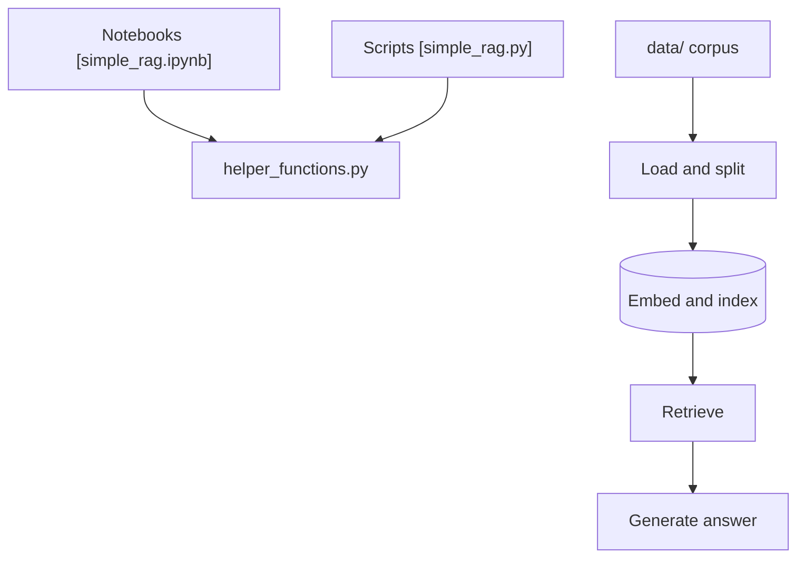

# NirDiamant/RAG_Techniques

> Collection of over 40 runnable notebooks presenting RAG techniques, from basic to advanced.

## The problem
RAG techniques (chunking, queries, reranking, graphs, evaluation) are scattered across articles with no comparable code.

## What it actually does
Independent Jupyter notebooks and Python scripts, one per technique: semantic chunking, HyDE, HyPE, fusion, reranking, Self-RAG, CRAG, GraphRAG, RAPTOR, MemoRAG, evaluation (DeepEval, GroUSE, RAGAS, Open-RAG-Eval). No common orchestrator, just a shared `helper_functions.py`.

## How it is wired


## Trying it
The supplied README gives no installation command.
```bash
# ouvrir all_rag_techniques/simple_rag.ipynb, ou lancer
# all_rag_techniques_runnable_scripts/simple_rag.py
```

## Cost and gotchas
The examples call third-party models and services (OpenAI, Contextual AI, Milvus, Ollama depending on the technique), so keys at your expense. The README promotes books and a newsletter.

## What it is not
Not an installable library or a product: independent tutorials. License not identified by GitHub. README truncated at the end of the document.

## Alternatives
None named as alternatives; neighboring repositories by the author are cited (Agents Towards Production, GenAI Agents, Agent Memory Techniques).

## For you
Adopt it as a learning reference: each RAG technique can be tested in isolation, but check the license before reusing code.
