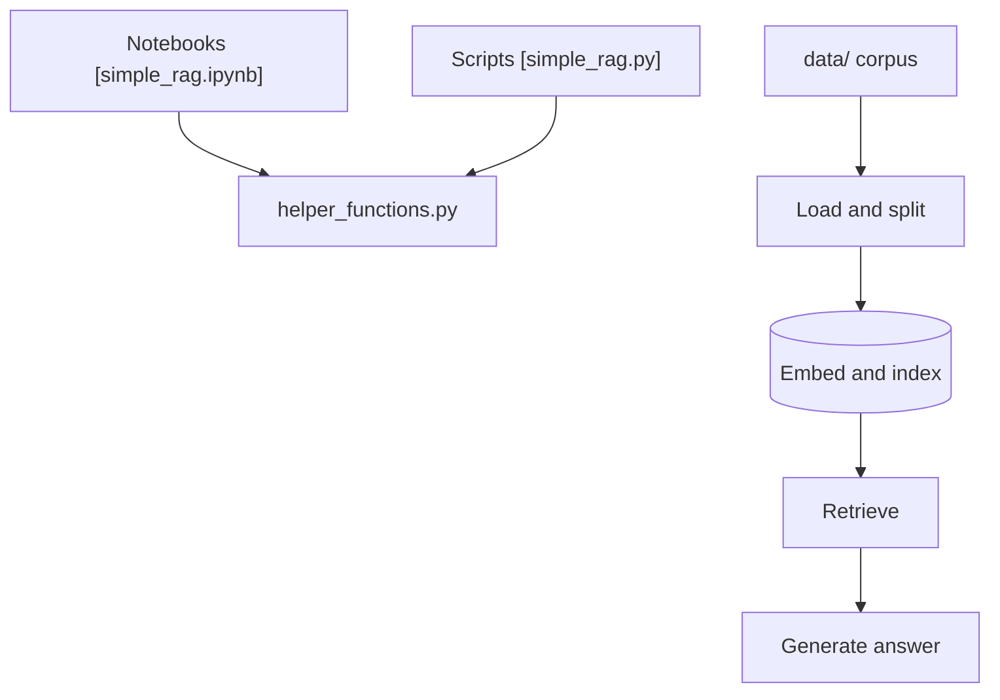

# NirDiamant/RAG_Techniques

> Collection de plus de 40 notebooks exécutables présentant des techniques de RAG, du basique à l'avancé.

## Le problème
Les techniques RAG (chunking, requêtes, reranking, graphes, évaluation) sont dispersées en articles sans code comparable.

## Ce que ça fait vraiment
Notebooks Jupyter et scripts Python indépendants, un par technique : chunking sémantique, HyDE, HyPE, fusion, reranking, Self-RAG, CRAG, GraphRAG, RAPTOR, MemoRAG, évaluation (DeepEval, GroUSE, RAGAS, Open-RAG-Eval). Pas d'orchestrateur commun, juste un `helper_functions.py` partagé.

## Comment c'est branché


## Essayer
Le README fourni ne donne pas de commande d'installation.
```bash
# ouvrir all_rag_techniques/simple_rag.ipynb, ou lancer
# all_rag_techniques_runnable_scripts/simple_rag.py
```

## Coût et pièges
Les exemples appellent des modèles et services tiers (OpenAI, Contextual AI, Milvus, Ollama selon la technique), donc des clés à ta charge. Le README promeut des livres et une newsletter.

## Ce que ce n'est pas
Pas une bibliothèque installable ni un produit : des tutoriels indépendants. Licence non identifiée par GitHub. README tronqué en fin de document.

## Alternatives
Aucune nommée comme alternative ; dépôts voisins de l'auteur cités (Agents Towards Production, GenAI Agents, Agent Memory Techniques).

## Pour toi
À adopter comme référence d'apprentissage : chaque technique RAG est testable isolément, mais vérifie la licence avant de réutiliser du code.

