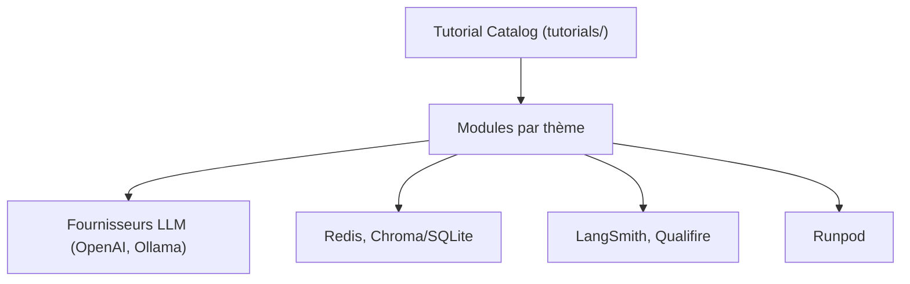

# NirDiamant/agents-towards-production

> Collection of executable tutorials to take AI agents from prototype to production.

## The problem
Agent tutorials stop at the prototype and ignore deployment, memory, security, observability.

## What it actually does
One folder per tutorial (notebook or code): secure tools, web scraping, RAG, memory (Redis, Mem0, Cognee), deployment (Docker, Ollama, Runpod, Bedrock AgentCore), A2A, MCP, LangGraph, FastAPI, security (LlamaFirewall, Apex), LoRA fine-tuning, LangSmith, evaluation, Streamlit. Several rely on partner services.

## How it is wired


## Trying it
```bash
git clone https://github.com/NirDiamant/agents-towards-production.git
cd agents-towards-production
cd tutorials/agent-with-streamlit-ui
pip install -r requirements.txt
jupyter notebook tutorial.ipynb
```

## Cost and gotchas
Many tutorials require third-party accounts and keys. One tutorial (hushvert) is flagged as out of service. Very promotional README (books, newsletter, affiliate links, tracking links).

## What it is not
Not a framework: isolated examples, one environment per folder. The README disclaims all warranty (educational use).

## Alternatives
No alternative named in the README (it points to other repositories by the same author).

## For you
Keep an eye on it: good thematic index to build skills, to pick from tutorial by tutorial; license not identified.
