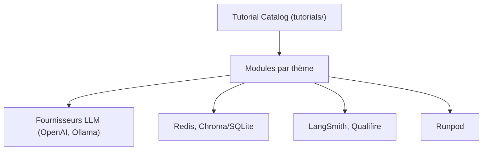

# NirDiamant/agents-towards-production

> Recueil de tutoriels exécutables pour amener des agents IA du prototype à la production.

## Le problème
Les tutoriels d'agents s'arrêtent au prototype et ignorent déploiement, mémoire, sécurité, observabilité.

## Ce que ça fait vraiment
Un dossier par tutoriel (notebook ou code) : outils sécurisés, collecte web, RAG, mémoire (Redis, Mem0, Cognee), déploiement (Docker, Ollama, Runpod, Bedrock AgentCore), A2A, MCP, LangGraph, FastAPI, sécurité (LlamaFirewall, Apex), fine-tuning LoRA, LangSmith, évaluation, Streamlit. Plusieurs reposent sur des services de partenaires.

## Comment c'est branché


## Essayer
```bash
git clone https://github.com/NirDiamant/agents-towards-production.git
cd agents-towards-production
cd tutorials/agent-with-streamlit-ui
pip install -r requirements.txt
jupyter notebook tutorial.ipynb
```

## Coût et pièges
Beaucoup de tutoriels exigent des comptes et clés tiers. Un tutoriel (hushvert) est signalé hors service. README très promotionnel (livres, newsletter, liens d'affiliation, liens de suivi).

## Ce que ce n'est pas
Pas un framework : des exemples isolés, un environnement par dossier. Le README décline toute garantie (usage éducatif).

## Alternatives
Aucune alternative nommée dans le README (renvoie à d'autres dépôts du même auteur).

## Pour toi
Surveiller : bon index thématique pour monter en compétence, à piocher tutoriel par tutoriel ; licence non identifiée.

