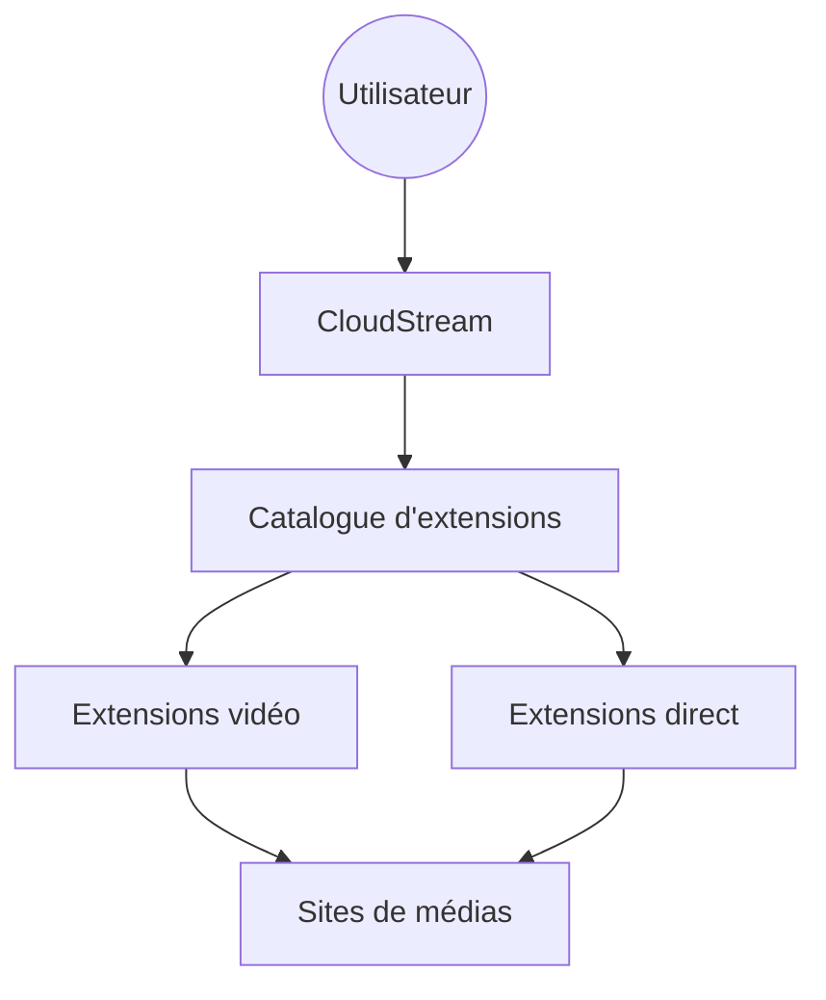

# NivinCNC/CNCVerse-Cloud-Stream-Extension

> Catalogue of 41 extensions for the CloudStream app: movies, series, live and audiobooks.

## The problem
CloudStream has no content sources of its own; you have to add extension repositories to it.

## What it actually does
A repository to add in CloudStream (short code `cncv` or the link to the `CNC.json` file). Each extension browses an external site and fetches the media. The README table gives the status: most are "Working", one "Broken", one geo-restricted. The provided tree only contains logos: the extensions' code cannot be verified here.

## How it is wired


## Trying it
```bash
# Dans CloudStream, ajouter le dépôt (code court) :
cncv
# ou coller l'URL du manifeste :
https://raw.githubusercontent.com/NivinCNC/CNCVerse-Cloud-Stream-Extension/refs/heads/builds/CNC.json
```

## Cost and gotchas
Free, but depends on CloudStream and on third-party sites that change or go down. The README leaves legal responsibility to the user (DMCA notice).

## What it is not
Not a video player nor a content host. Nothing to do with data or AI.

## Alternatives
No alternative named in the README.

## For you
Ignore: entertainment unrelated to your work, undeclared licence and legal status of the content left to the user.
