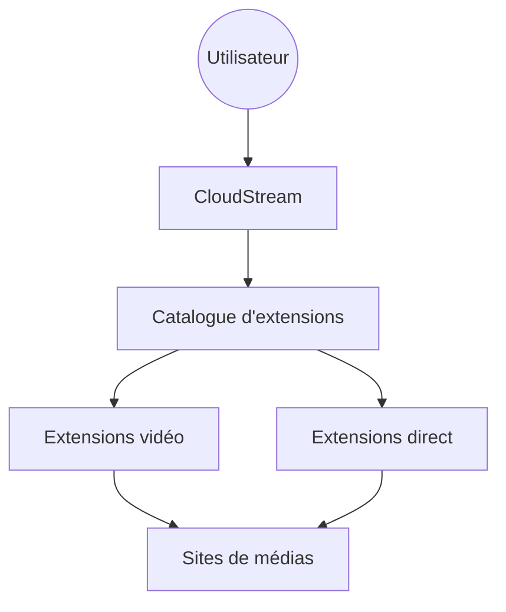

# NivinCNC/CNCVerse-Cloud-Stream-Extension

> Catalogue de 41 extensions pour l'application CloudStream : films, séries, direct et livres audio.

## Le problème
CloudStream n'a pas de sources de contenu en propre ; il faut y ajouter des dépôts d'extensions.

## Ce que ça fait vraiment
Dépôt à ajouter dans CloudStream (code court `cncv` ou lien du fichier `CNC.json`). Chaque extension navigue sur un site externe et récupère le média. Le tableau du README indique le statut : la plupart « Working », une « Broken », une géo-restreinte. L'arbre fourni ne contient que des logos : le code des extensions n'est pas vérifiable ici.

## Comment c'est branché


## Essayer
```bash
# Dans CloudStream, ajouter le dépôt (code court) :
cncv
# ou coller l'URL du manifeste :
https://raw.githubusercontent.com/NivinCNC/CNCVerse-Cloud-Stream-Extension/refs/heads/builds/CNC.json
```

## Coût et pièges
Gratuit, mais dépend de CloudStream et de sites tiers qui changent ou tombent. Le README renvoie la responsabilité légale à l'utilisateur (avis DMCA).

## Ce que ce n'est pas
Pas un lecteur vidéo ni un hébergeur de contenu. Rien à voir avec la data ou l'IA.

## Alternatives
Aucune alternative nommée dans le README.

## Pour toi
Ignorer : divertissement sans lien avec ton métier, licence non déclarée et statut légal du contenu laissé à l'utilisateur.

