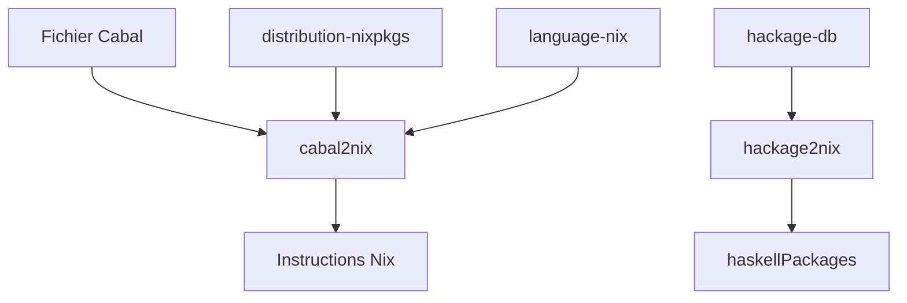

# NixOS/cabal2nix

> Monorepo of tools that generate Nix build instructions from Haskell Cabal files.

## The problem
Packaging Haskell libraries in Nix by hand is slow and repetitive.

## What it actually does
`cabal2nix` produces the Nix instructions for a Cabal file, and `hackage2nix` generates the nixpkgs `haskellPackages` set. Three libraries come with it: `distribution-nixpkgs` (nixpkgs-specific tasks), `language-nix` (parsing a subset of Nix) and `hackage-db` (Hackage database). The monorepo was assembled with josh.

## How it is wired
Simplified diagram based on the sheet, no diagram provided.


## Trying it
```bash
nix-shell -p josh
josh-filter ':/distribution-nixpkgs'
```

## Cost and gotchas
Free. Requires Nix and the Haskell toolchain (not in the prerequisites list); `cabal.project` and `shell.nix` are for development. License present but not identified by GitHub.

## What it is not
Not a tool for other languages; the README gives no usage command for `cabal2nix` itself.

## Alternatives
No alternative named in the README.

## For you
Ignore: useful only to Haskell packagers on Nix, not to a data / MLOps profile.
