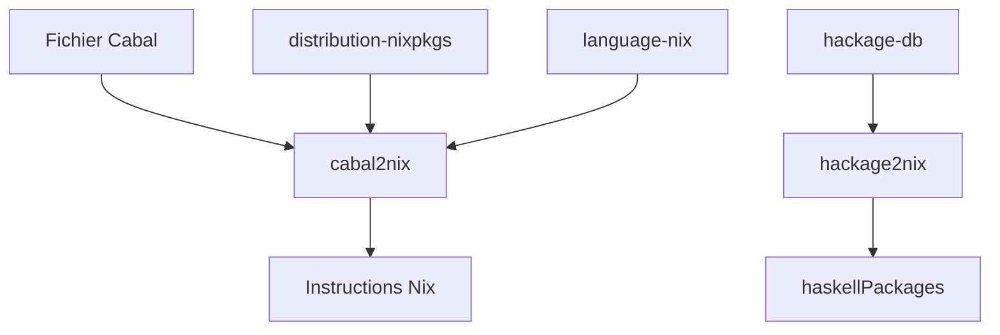

# NixOS/cabal2nix

> Monorepo d'outils qui génèrent des instructions de construction Nix à partir de fichiers Cabal Haskell.

## Le problème
Packager des bibliothèques Haskell dans Nix à la main est long et répétitif.

## Ce que ça fait vraiment
`cabal2nix` produit les instructions Nix d'un fichier Cabal, et `hackage2nix` génère l'ensemble `haskellPackages` de nixpkgs. Trois bibliothèques accompagnent : `distribution-nixpkgs` (tâches propres à nixpkgs), `language-nix` (analyse d'un sous-ensemble de Nix) et `hackage-db` (base Hackage). Le monorepo a été assemblé avec josh.

## Comment c'est branché
Schéma simplifié d'après la fiche, sans diagramme fourni.


## Essayer
```bash
nix-shell -p josh
josh-filter ':/distribution-nixpkgs'
```

## Coût et pièges
Gratuit. Il faut Nix et la chaîne Haskell (hors liste de prérequis) ; `cabal.project` et `shell.nix` servent au développement. Licence présente mais non identifiée par GitHub.

## Ce que ce n'est pas
Ce n'est pas un outil pour d'autres langages ; le README ne donne pas de commande d'usage de `cabal2nix` lui-même.

## Alternatives
Aucune alternative nommée dans le README.

## Pour toi
À ignorer : utile uniquement aux packageurs Haskell sous Nix, pas à un profil data / MLOps.

