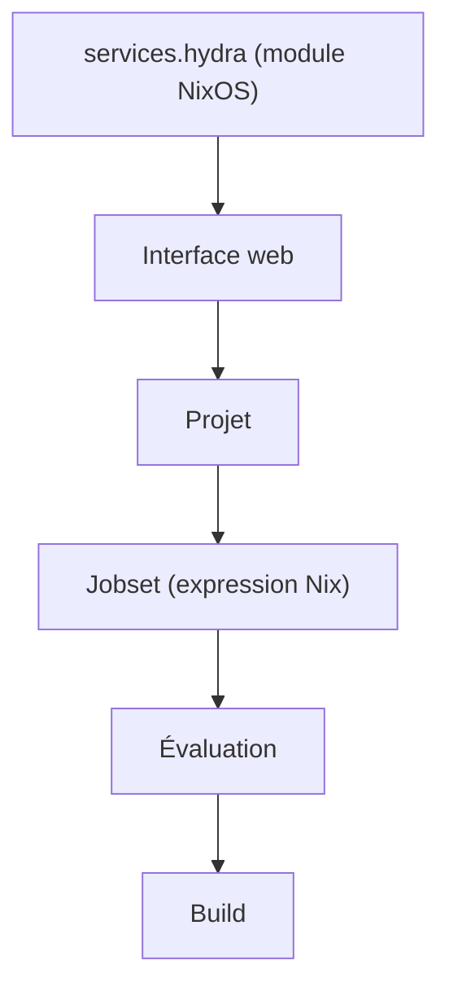

# NixOS/hydra

> Continuous integration service for Nix projects, supported only on NixOS.

## The problem
Continuously evaluating and building Nix expressions requires a service that manages projects, jobsets and build machines.

## What it actually does
A NixOS module launches the service with a web interface (port 3000 by default). You create an admin user, a project, then a jobset that evaluates a Nix expression at regular intervals. A JSON API (hydra-api.yaml) is available. Development uses foreman, ninja, cargo and meson.

## How it is wired
Simplified diagram based on the sheet, no diagram provided.


## Trying it
```bash
su - hydra
hydra-create-user <USER> --full-name '<NAME>' --email-address '<EMAIL>' --password-prompt --role admin
nix build
nix develop
```

## Cost and gotchas
Free. Works only on NixOS; the README configuration is local and not sufficient for production. 395 open issues.

## What it is not
Not a general-purpose CI: it assumes Nix and NixOS, with PostgreSQL for the database.

## Alternatives
No alternative named in the README.

## For you
Ignore, unless your MLOps is entirely built on Nix: it is then the official CI of that ecosystem.
