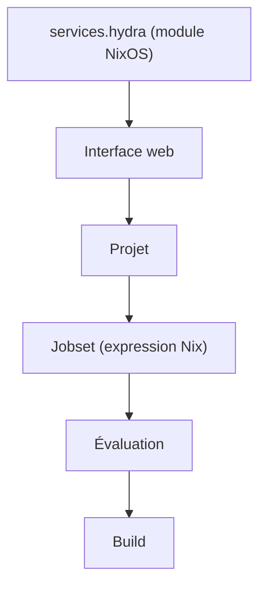

# NixOS/hydra

> Service d'intégration continue pour les projets Nix, pris en charge uniquement sous NixOS.

## Le problème
Évaluer et construire en continu des expressions Nix demande un service qui gère les projets, jobsets et machines de build.

## Ce que ça fait vraiment
Un module NixOS lance le service avec une interface web (port 3000 par défaut). On crée un utilisateur admin, un projet puis un jobset qui évalue une expression Nix à intervalle régulier. Une API JSON (hydra-api.yaml) est disponible. Le développement utilise foreman, ninja, cargo et meson.

## Comment c'est branché
Schéma simplifié d'après la fiche, sans diagramme fourni.


## Essayer
```bash
su - hydra
hydra-create-user <USER> --full-name '<NAME>' --email-address '<EMAIL>' --password-prompt --role admin
nix build
nix develop
```

## Coût et pièges
Gratuit. Fonctionne seulement sous NixOS ; la configuration du README est locale et ne suffit pas pour la production. 395 issues ouvertes.

## Ce que ce n'est pas
Ce n'est pas un CI généraliste : il suppose Nix et NixOS, avec PostgreSQL pour la base.

## Alternatives
Aucune alternative nommée dans le README.

## Pour toi
À ignorer, sauf si ton MLOps est entièrement fondé sur Nix : c'est alors le CI officiel de cet écosystème.

