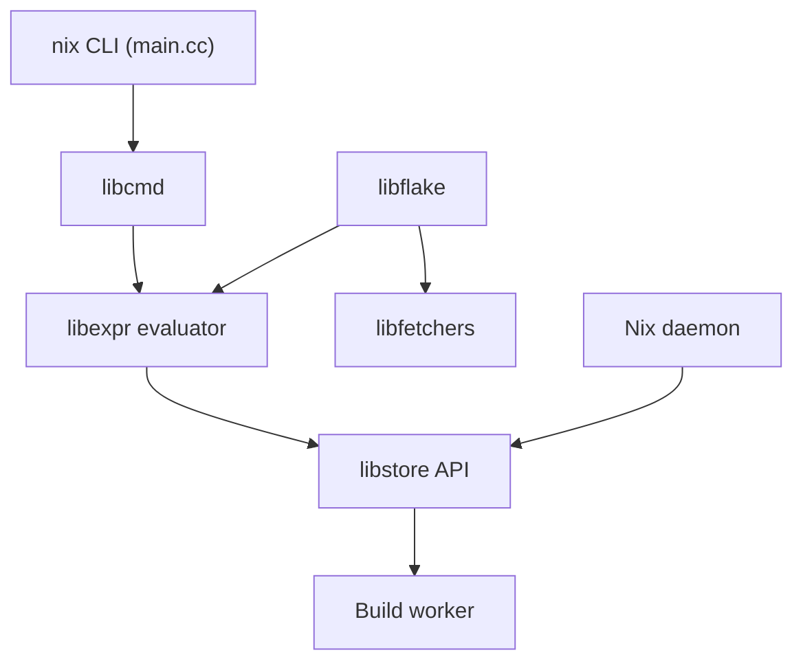

# NixOS/nix

> Reproducible package manager for Linux and Unix, for those who want identical declarative environments.

## The problem
Environments drift from one machine to another; reproducing a build or a set of dependencies is fragile.

## What it actually does
Implements the Nix language, evaluates expressions into derivations, builds in a sandbox and stores the result in a content-addressed store. Supports flakes (input locking) and binary caches. A daemon serves multi-user mode.

## How it is wired
Diagram based on the code diagram, simplified.

## Trying it
No commands in the README: installation is described on nix.dev and in the manual.

## Cost and gotchas
Free (LGPL-2.1, copyleft license). Learning curve of the Nix language, not quantified in the README. Many open issues (3,038).

## What it is not
Neither a container manager nor a simple apt. NixOS is a separate distribution. The README refers to nix.dev for all the detail.

## Alternatives
None named in the README.

## For you
Worth watching: interesting for reproducible ML environments, but the learning investment is real; a test on a small project will settle it.
