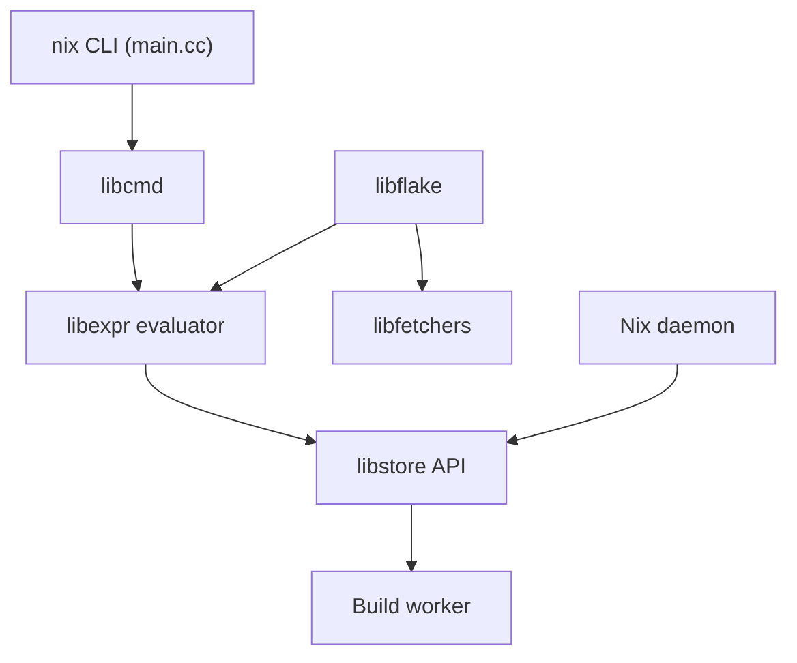

# NixOS/nix

> Gestionnaire de paquets reproductible pour Linux et Unix, pour qui veut des environnements déclaratifs identiques.

## Le problème
Les environnements dérivent d'une machine à l'autre ; reproduire un build ou un jeu de dépendances est fragile.

## Ce que ça fait vraiment
Implémente le langage Nix, évalue des expressions en dérivations, construit dans un bac à sable et range le résultat dans un store adressé par contenu. Supporte les flakes (verrouillage des entrées) et les caches binaires. Un démon sert le mode multi-utilisateur.

## Comment c'est branché
Schéma d'après le diagramme du code, simplifié.

## Essayer
Aucune commande dans le README : l'installation est décrite sur nix.dev et le manuel.

## Coût et pièges
Gratuit (LGPL-2.1, licence copyleft). Courbe d'apprentissage du langage Nix, non chiffrée dans le README. Beaucoup d'issues ouvertes (3 038).

## Ce que ce n'est pas
Ni un gestionnaire de conteneurs ni un simple apt. NixOS est une distribution distincte. Le README renvoie à nix.dev pour tout le détail.

## Alternatives
Aucune nommée dans le README.

## Pour toi
À surveiller : intéressant pour des environnements ML reproductibles, mais l'investissement d'apprentissage est réel ; un test sur un petit projet tranchera.

