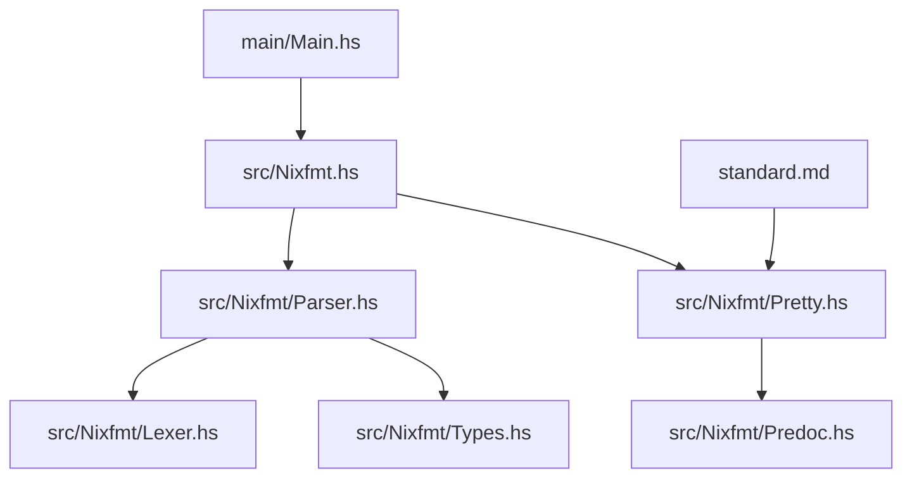

# NixOS/nixfmt

> Official formatter for the Nix language, which applies a style defined in standard.md.

## The problem
Nix files are formatted differently depending on the author, which pollutes diffs and reviews.

## What it actually does
Main.hs reads a Nix file and calls Nixfmt.hs, which turns it into a tree using Lexer and Parser, typed by Types.hs. Pretty.hs converts the tree into an intermediate document that Predoc.hs lays out. Processes one file at a time; integrations (treefmt, pre-commit, git mergetool) extend it to a whole project.

## How it is wired


## Trying it
```bash
nixfmt < input.nix
nixfmt file.nix
nixfmt --follow-symlinks link.nix
```

## Cost and gotchas
Free. Installed via nixpkgs (`pkgs.nixfmt`). Without `--follow-symlinks`, a symbolic link is replaced by a regular file.

## What it is not
Not a linter: it formats without flagging logic defects. It only processes one file per call.

## Alternatives
nixfmt-tree and treefmt-nix are cited for formatting a whole project.

## For you
Ignore, unless you manage your ML environments with Nix: the formatter is then the official route.
