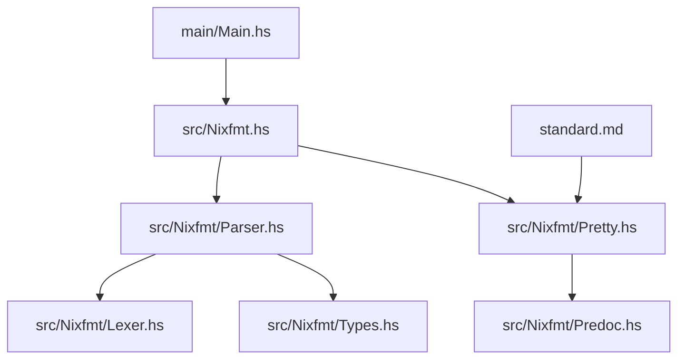

# NixOS/nixfmt

> Formateur officiel du langage Nix, qui applique un style défini dans standard.md.

## Le problème
Les fichiers Nix se formatent différemment selon les auteurs, ce qui pollue les diffs et les revues.

## Ce que ça fait vraiment
Main.hs lit un fichier Nix et appelle Nixfmt.hs, qui le transforme en arbre grâce à Lexer et Parser, typés par Types.hs. Pretty.hs convertit l'arbre en document intermédiaire que Predoc.hs met en page. Traite un fichier à la fois ; des intégrations (treefmt, pre-commit, git mergetool) étendent à un projet entier.

## Comment c'est branché


## Essayer
```bash
nixfmt < input.nix
nixfmt file.nix
nixfmt --follow-symlinks link.nix
```

## Coût et pièges
Gratuit. S'installe via nixpkgs (`pkgs.nixfmt`). Sans `--follow-symlinks`, un lien symbolique est remplacé par un fichier ordinaire.

## Ce que ce n'est pas
Ce n'est pas un linter : il formate sans signaler de défauts de logique. Il ne traite qu'un fichier par appel.

## Alternatives
nixfmt-tree et treefmt-nix sont cités pour formater un projet entier.

## Pour toi
À ignorer, sauf si tu gères tes environnements ML avec Nix : le formateur y est alors la voie officielle.

