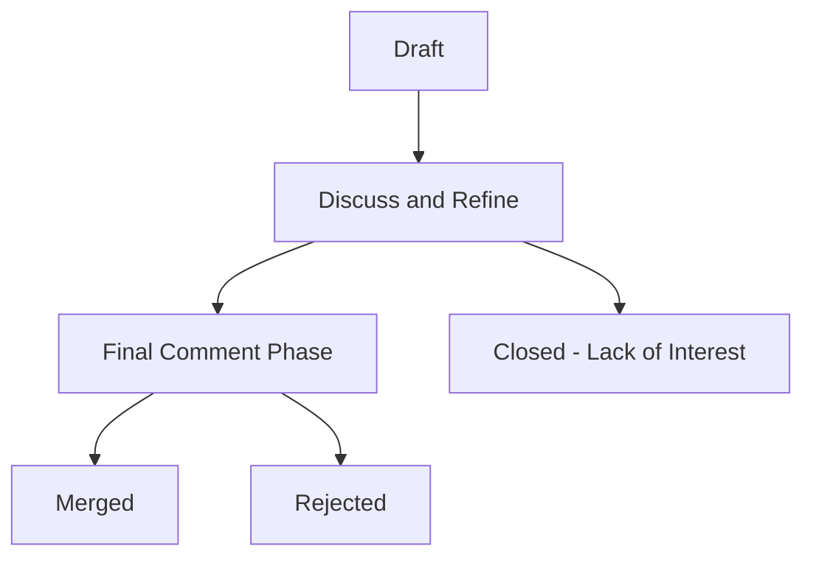

# NixOS/rfcs

> Repository of proposals for major changes to Nix and Nixpkgs and of their decision process.

## The problem
Major changes in the Nix ecosystem require a community consensus, traced and dated.

## What it actually does
Contains the accepted RFCs under `rfcs/` and describes the process: drafting, steering committee, shepherd team, a ten-day final comment period, merge or rejection. The repository is moving to an on-demand mode of operation, given the drop in activity.

## How it is wired

## Trying it
No command: you open a pull request with a Markdown file in `rfcs/`.

## Cost and gotchas
No cost. CC-BY-SA-4.0 licence (share-alike). Last push in June 2026 and reduced activity.

## What it is not
Not a tool nor software. An accepted RFC does not guarantee that the change will be implemented.

## Alternatives
None cited in the README. Matrix Spec Proposals is given as a comparison of tone.

## For you
Ignore: unless you contribute to Nix, these are governance documents with no use for a data / AI profile.
