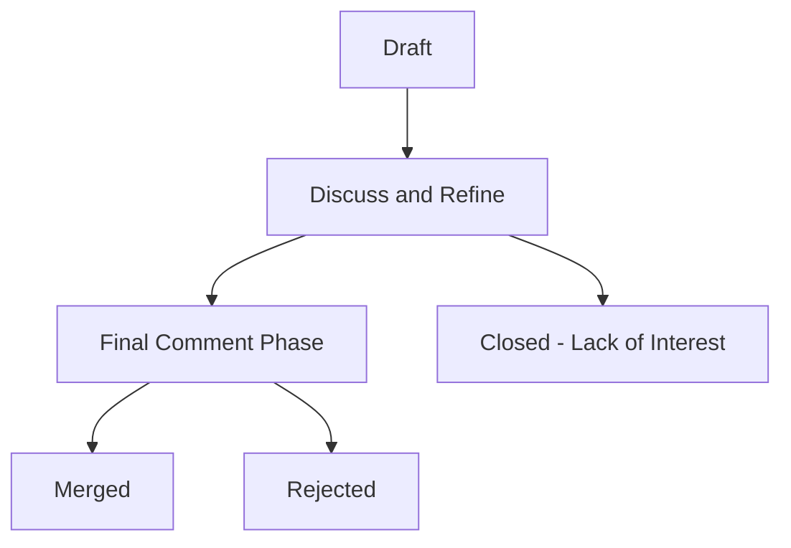

# NixOS/rfcs

> Dépôt des propositions de changements majeurs de Nix et Nixpkgs et de leur processus de décision.

## Le problème
Les changements importants de l'écosystème Nix demandent un consensus de la communauté, tracé et daté.

## Ce que ça fait vraiment
Contient les RFC acceptés sous `rfcs/` et décrit le processus : rédaction, comité de pilotage, équipe de shepherds, période de commentaire finale de dix jours, fusion ou rejet. Le dépôt passe à un fonctionnement à la demande, vu la baisse d'activité.

## Comment c'est branché

## Essayer
Aucune commande : on ouvre une pull request avec un fichier Markdown dans `rfcs/`.

## Coût et pièges
Aucun coût. Licence CC-BY-SA-4.0 (partage à l'identique). Dernier push en juin 2026 et activité réduite.

## Ce que ce n'est pas
Pas un outil ni un logiciel. Un RFC accepté ne garantit pas que le changement soit implémenté.

## Alternatives
Aucune citée dans le README. Matrix Spec Proposals est donné comme comparaison de ton.

## Pour toi
Ignorer : sauf si tu contribues à Nix, ce sont des documents de gouvernance sans usage pour un profil data / IA.

