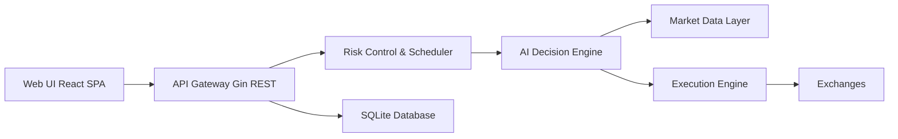

# NoFxAiOS/nofx

> Crypto trading terminal where an LLM decides, under risk guardrails coded in Go.

## The problem
Letting an LLM trade without limits exposes you to losses; you need a risk layer out of the model's reach.

## What it actually does
Continuous loop: market reading, LLM decision, execution, recording of the reasoning.
Coded limits: max positions, leverage caps, exchange-side stop-loss, close on drawdown, cooldowns, safe mode.
Nine exchanges (Binance, Bybit, OKX, Hyperliquid…), eight LLM providers or pay-per-call through Claw402 (USDC).
Dashboard, strategy studio, public leaderboard.

## How it is wired


## Trying it
```bash
curl -fsSL https://raw.githubusercontent.com/NoFxAiOS/nofx/main/install.sh | bash
docker compose -f docker-compose.prod.yml up -d
```

## Cost and gotchas
Real money: USDC deposit for AI fees and funds on the exchange; affiliate sign-up links. Losses possible.

## What it is not
Not a rigorous backtesting tool nor financial advice; decisions fed by the Claw402/Vergex data stack.

## Alternatives
No alternative named in the README.

## For you
Ignore: the "the model proposes, the runtime decides" pattern is instructive, but the product commits real money through an affiliate SaaS.
