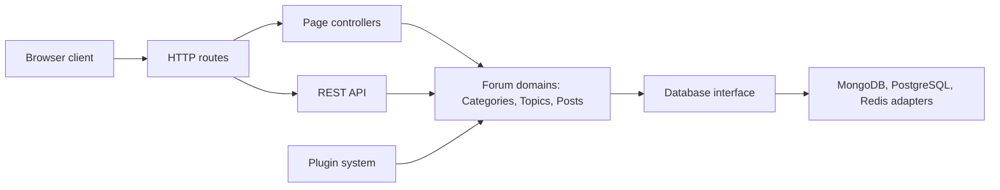

# NodeBB/NodeBB

> Self-hosted forum software on Node.js, with real-time notifications, for anyone who wants their own online community.

## The problem
Hosting a discussion community without depending on a third-party platform or on old forum software without real time.

## What it actually does
Forum with categories, local accounts, private messaging and groups. It exposes a read/write REST API and WebSockets for instant exchanges. The core is minimal: the rest goes through third-party plugins and themes ("Harmony" theme, Bootstrap 5). It runs on MongoDB, Redis or PostgreSQL. Optional ActivityPub federation is mentioned in the architecture as described from the code.

## How it is wired


## Trying it
```bash
docker-compose up
```
The README then points to http://localhost:4567. It specifies that NodeBB is not launched with `npm start` (CLI installation).

## Cost and gotchas
Free, but Node.js 22+ and MongoDB 5+ or Redis 7.2+ must be installed; Redis is mandatory in cluster mode. The README warns that Redis listens on all interfaces by default: restrict it (`bind_address`, `requirepass`, firewall).

## What it is not
Not a data/AI tool: it is a community web application. Features beyond the base depend on third-party plugins. A "premium" hosting offer exists, without the README giving its price.

## Alternatives
No alternative named in the README.

## For you
Ignore: a self-hosted forum is outside the data/AI/MLOps scope, and the GPL-3.0 license requires sharing distributed modifications.
