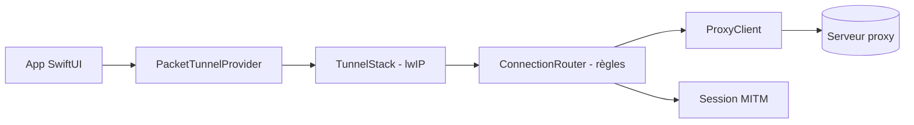

# NodePassProject/Anywhere

> Native proxy client for iOS, iPadOS and tvOS, written in Swift with its own network stack.

## The problem
iOS proxy clients often wrap sing-box or Xray-core through a Go or C++ bridge.

## What it actually does
A Swift application with a network extension (packet tunnel) that implements, without any third-party stack: TLS (browser fingerprints, Reality, ECH), QUIC (ngtcp2), five-level routing, Fake-IP DNS and HTTPS interception (MITM) rewriting traffic by rules or JavaScript. Protocols: Nowhere, VLESS, Hysteria2, Sudoku, Trojan, AnyTLS, Shadowsocks, SOCKS5, RFC. Targets: iOS, iPadOS, tvOS, watchOS, Control Center controls and iCloud sync.

## How it is wired

## Trying it
No command in the README. Usage documented through links: `anywhere://add-proxy?link=<link>` and `anywhere://add-rule-set?link=<url>` to import a proxy or rules.

## Cost and gotchas
An existing proxy server is required. The MITM generates a root authority: handle with care. The GPL-3.0 license does not cover the "Anywhere" name or icon: replace them if you fork.

## What it is not
Not a VPN service nor a proxy server. The README's "best client" claim is the author's own, with no comparison.

## Alternatives
sing-box and Xray-core, cited as the clients this one avoids wrapping.

## For you
Ignore: an iOS network client unrelated to data or MLOps, with sensitive circumvention and interception uses.
