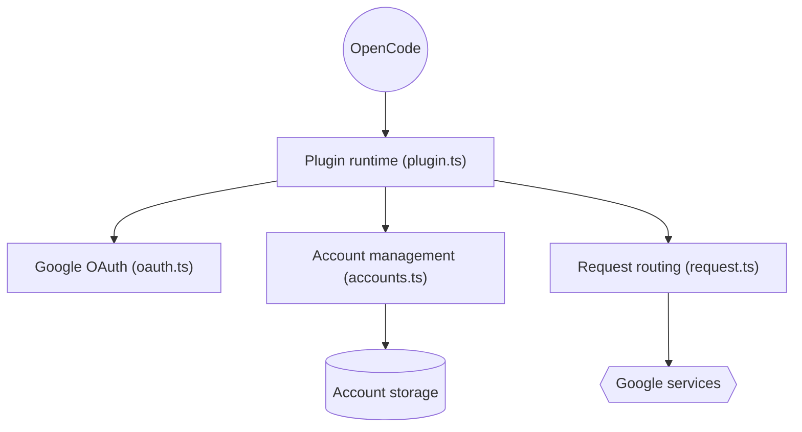

# NoeFabris/opencode-antigravity-auth

> OpenCode plugin that connects a Google account to Antigravity and Gemini CLI to access their models.

## The problem
Using Antigravity's models and quotas from OpenCode without going through Google's IDE.

## What it actually does
Authenticates through Google OAuth, manages several accounts with rotation and quota tracking, prepares requests according to the model (Gemini, Claude), transforms streams, recovers errored sessions, adds search grounding. An `/antigravity` menu lists accounts and quotas. Accounts are stored in `~/.config/opencode/antigravity-accounts.json`.

## How it is wired


## Trying it
```bash
opencode auth login google
opencode models
opencode run --model=google/antigravity-gemini-3.8-flash-high "Hello"
```
Add `"plugins": ["opencode-antigravity-auth@2.1.2"]` to `~/.config/opencode/opencode.json`.

## Cost and gotchas
Depends on your Google plan. The README warns: unofficial plugin, Google may restrict accounts that use third-party clients. The accounts file contains credentials. OpenCode 2.1.2+ and Node 20+.

## What it is not
Not an official offering from Google or OpenCode. Risk of account blocking.

## Alternatives
None named in the README.

## For you
Ignore: risk of your Google account being restricted and dependence on a third-party service; use an official API key.
