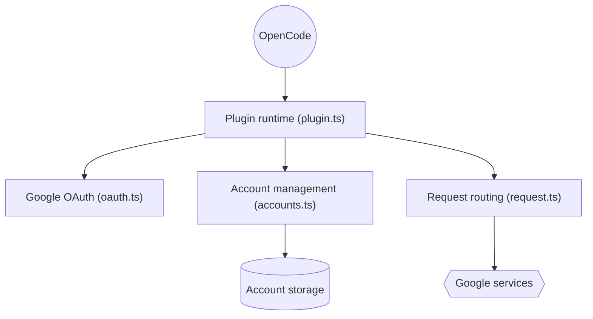

# NoeFabris/opencode-antigravity-auth

> Plugin OpenCode qui connecte un compte Google à Antigravity et Gemini CLI pour accéder à leurs modèles.

## Le problème
Utiliser les modèles et quotas d'Antigravity depuis OpenCode sans passer par l'IDE de Google.

## Ce que ça fait vraiment
Authentifie par OAuth Google, gère plusieurs comptes avec rotation et suivi de quota, prépare les requêtes selon le modèle (Gemini, Claude), transforme les flux, récupère les sessions en erreur, ajoute de l'ancrage par recherche. Un menu `/antigravity` liste comptes et quotas. Les comptes sont dans `~/.config/opencode/antigravity-accounts.json`.

## Comment c'est branché


## Essayer
```bash
opencode auth login google
opencode models
opencode run --model=google/antigravity-gemini-3.8-flash-high "Hello"
```
Ajouter `"plugins": ["opencode-antigravity-auth@2.1.2"]` dans `~/.config/opencode/opencode.json`.

## Coût et pièges
Dépend de ton forfait Google. Le README prévient : plugin non officiel, Google peut restreindre les comptes qui utilisent des clients tiers. Le fichier de comptes contient des identifiants. OpenCode 2.1.2+ et Node 20+.

## Ce que ce n'est pas
Pas une offre officielle de Google ni d'OpenCode. Risque de blocage de compte.

## Alternatives
Aucune nommée dans le README.

## Pour toi
Ignorer : risque de restriction de ton compte Google et dépendance à un service tiers ; utiliser une clé d'API officielle.

