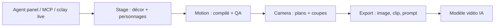

# NomaDamas/CozyClay

> In-browser 3D preview studio that prepares shot, motion and camera before generating an AI video.

## The problem
Every AI video attempt costs money, and a text prompt fixes neither positions, nor movements, nor camera, nor cuts.

## What it actually does
You build a 3D set and characters, an agent writes a motion spec that a deterministic compiler bakes frame by frame, with QA checks (collisions, foot sliding, hand contact). You place shots on a timeline, then export first frame, greybox clip, camera, prompt, mp4, depth/normal passes and an OTIO cut list. Every modification, including those by the agent, is an undo step.

## How it is wired


## Trying it
```bash
npx cozyclay
# MCP : npx -y cozyclay mcp
# terminal : cclay live status --wait
# depuis les sources :
git clone https://github.com/NomaDamas/CozyClay.git && cd CozyClay
npm install
npm run dev
npm test
```

## Cost and gotchas
Node.js 22.19+ and a Chromium browser; no GPU and no Python. The agent requires a ChatGPT account or your own key (Anthropic, OpenAI, Gemini, OpenRouter, CLIProxyAPI), and the target video model is paid separately. Anonymous telemetry (can be disabled via `cclay telemetry off`, see `docs/privacy.md`).

## What it is not
It is not a video generator: it produces the 3D draft and the reference package to hand to an external model. AGPL-3.0: restrictive if you integrate it into a service.

## Alternatives
No alternative named in the README.

## For you
Worth watching: the "block in 3D then generate" flow reduces paid attempts and the MCP server integrates with Claude Code; the repo is three months old and remains to be proven.
