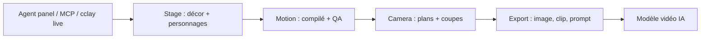

# NomaDamas/CozyClay

> Studio de prévisualisation 3D dans le navigateur qui prépare plan, mouvement et caméra avant de générer une vidéo par IA.

## Le problème
Chaque essai de vidéo IA se paie, et un prompt texte ne fixe ni les positions, ni les mouvements, ni la caméra, ni les coupes.

## Ce que ça fait vraiment
Tu montes un décor et des personnages en 3D, un agent écrit une spec de mouvement qu'un compilateur déterministe cuit image par image, avec contrôles QA (collisions, glissement des pieds, contact des mains). Tu poses des plans sur une timeline, puis exportes première image, clip greybox, caméra, prompt, mp4, passes profondeur/normales et cut list OTIO. Chaque modification, y compris celles de l'agent, est une étape d'annulation.

## Comment c'est branché


## Essayer
```bash
npx cozyclay
# MCP : npx -y cozyclay mcp
# terminal : cclay live status --wait
# depuis les sources :
git clone https://github.com/NomaDamas/CozyClay.git && cd CozyClay
npm install
npm run dev
npm test
```

## Coût et pièges
Node.js 22.19+ et un navigateur Chromium ; ni GPU ni Python. L'agent demande un compte ChatGPT ou ta clé (Anthropic, OpenAI, Gemini, OpenRouter, CLIProxyAPI), et le modèle vidéo cible se paie à part. Télémétrie anonyme (désactivable via `cclay telemetry off`, voir `docs/privacy.md`).

## Ce que ce n'est pas
Ce n'est pas un générateur de vidéo : il produit le brouillon 3D et le paquet de références à confier à un modèle externe. AGPL-3.0 : contraignant si tu l'intègres à un service.

## Alternatives
Aucune alternative nommée dans le README.

## Pour toi
À surveiller : le flux « bloquer en 3D puis générer » réduit les essais payants et le serveur MCP s'intègre à Claude Code ; le dépôt a trois mois et reste à éprouver.

