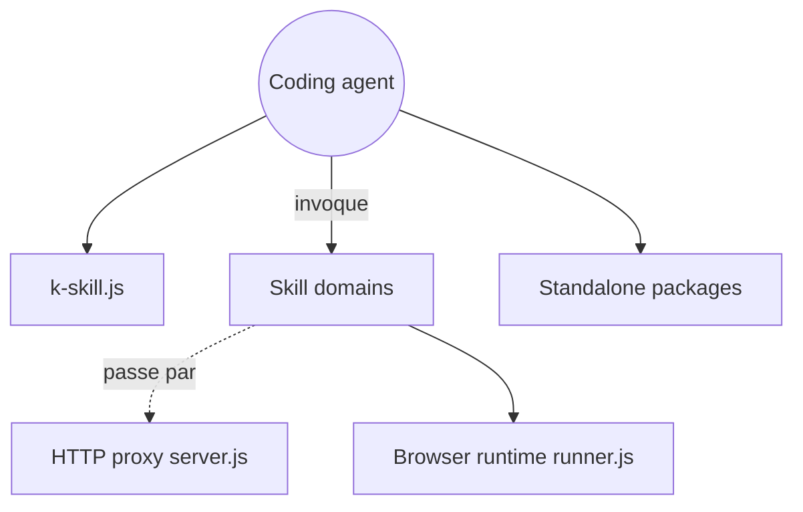

# NomaDamas/k-skill

> 125 skills for coding agents that automate everyday tasks in Korea (transport, paperwork, finance).

## The problem
Coding agents do not know how to query Korean public services and APIs (KTX, DART, Naver, Kakao, government agencies).

## What it actually does
Groups 125 skills by domain: transport, real estate, law, business and taxation, public aid, employment, finance, health, commerce, sports, culture. Many are read-only. Some go through an optional HTTP proxy (`k-skill-proxy`) to public APIs; others need keys or a browser. The README is in Korean.

## How it is wired


## Trying it
```bash
npx --yes skills add NomaDamas/k-skill --all -g
npx --yes skills add NomaDamas/k-skill --skill railway-timetable -g
/plugin marketplace add NomaDamas/k-skill
/plugin install k-skill@k-skill
```

## Cost and gotchas
Node 18+; Python 3.11+ and `uv` for the KTX helper. API keys to obtain via `k-skill-setup`. License: MIT, except `packages/k-skill-proxy/` and `infra/k-skill-proxy-dashboard/` under AGPL-3.0-only.

## What it is not
Not a rail booking tool: the rail skill is read-only. The skills depend on third-party sites, which may block or change. Use limited to public information, not mass use.

## Alternatives
No alternative named in the README.

## For you
Ignore: specific to Korea and everyday life; only the layout of a skills catalog with a shared proxy may inspire.
